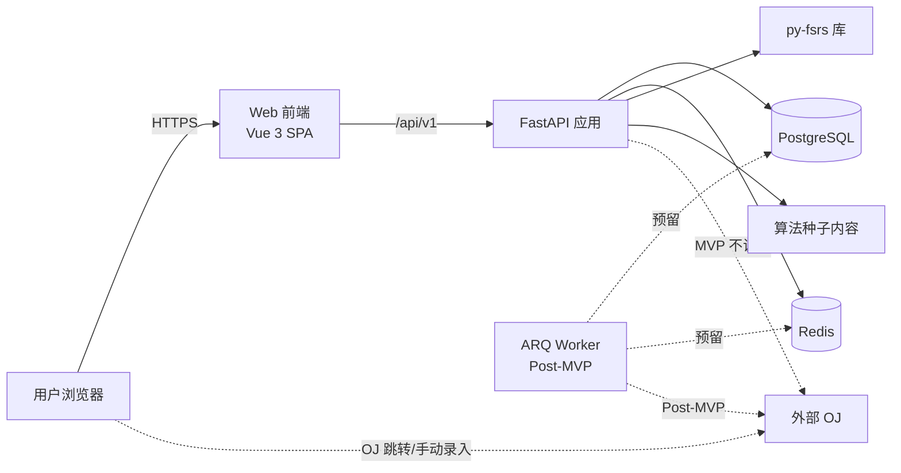
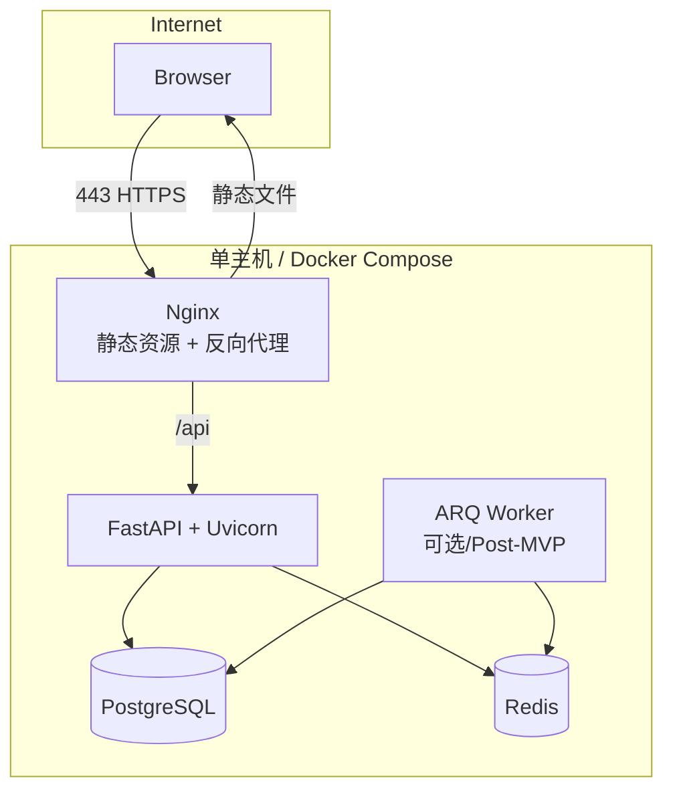
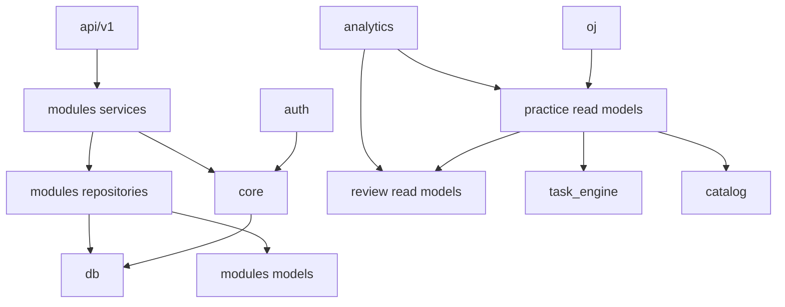
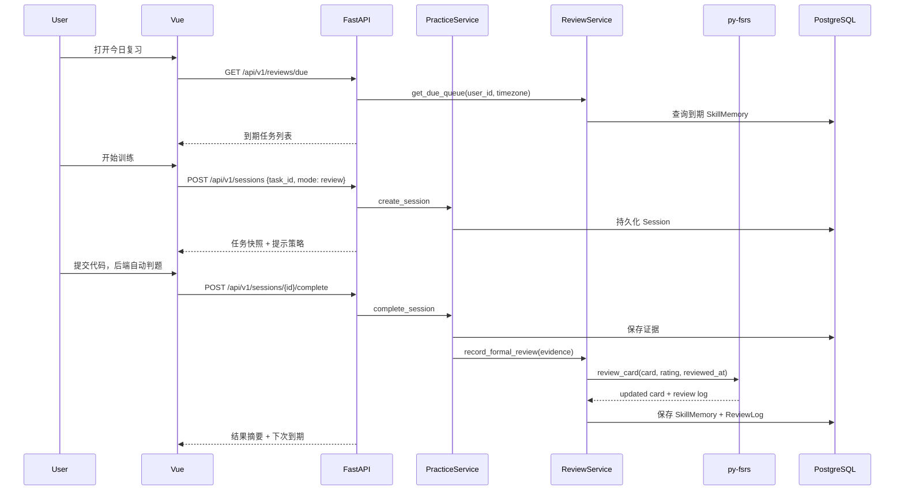
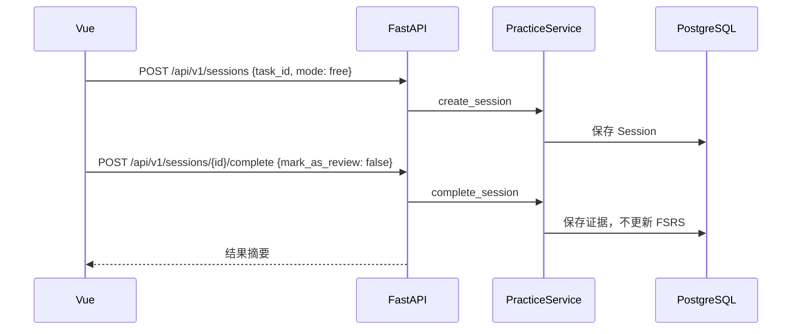
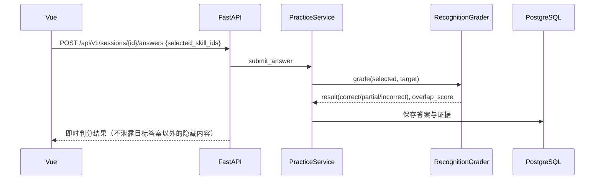
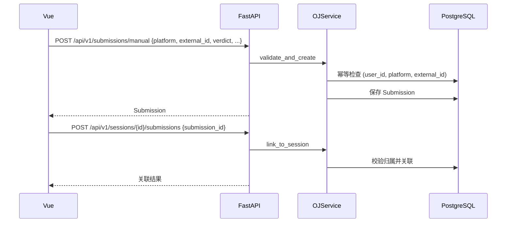
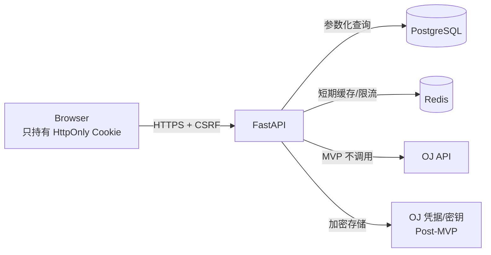

# MomoCode 系统架构设计（阶段 2）

| 项 | 内容 |
|---|---|
| 阶段 | 阶段 2：系统架构设计 |
| 版本 | v1.0 |
| 状态 | 待负责人确认，未开始业务编码 |
| 依据 | `docs/PRD.md` v1.0、`00_PROJECT_CONTEXT.md` |
| 日期 | 2026-11-10 |

> 本文档只描述架构与模块契约，不定义数据库字段细节（见阶段 3），不实现业务代码（见阶段 5 之后）。

---

## 1. 架构目标与约束

### 1.1 目标

1. 用一个**模块化单体**覆盖 MVP 的完整闭环：认证 → 算法库 → 四类训练 → 证据记录 → FSRS → 复习队列 → 基础分析。
2. 模块边界清晰，避免循环依赖；为后续接入 Codeforces 同步、第三方登录、更多 OJ 保留扩展点。
3. 训练证据与 FSRS 状态解耦：FSRS 只负责“何时复习”，Skill Score 只负责“能力表现”。
4. 所有用户数据按 `user_id` 隔离；认证、密钥与日志采用保守安全默认值。
5. 编码训练使用受限 Docker 判题容器运行内置测试用例；OJ 证据作为独立外部证据保留。
6. 技术栈遵循项目上下文：Vue 3 + TypeScript + Vite + Pinia + Vue Router + Monaco + ECharts；FastAPI + SQLAlchemy + Pydantic；PostgreSQL；Redis。

### 1.2 约束

- 默认模块化单体，不拆微服务。
- 前端不直连数据库，不持有服务端密钥。
- OJ Verdict 只是证据，不等于掌握；一次 AC 不自动更新为“已掌握”。
- FSRS 内部参数（Difficulty、Stability）不作为用户能力分数展示。
- MVP 的 OJ 能力只有“手动关联 + 题目跳转”，不调用外部 OJ API。
- 数据库结构变更必须有 Alembic 迁移；关键业务规则必须有测试。

---

## 2. 系统上下文与部署拓扑

### 2.1 系统上下文



说明：

- MVP 只有一个应用进程处理同步请求；`Worker` 是后续 OJ 同步、统计预聚合的扩展位，MVP 不启动。
- OJ 在 MVP 中只作为外部链接和用户手动录入的证据来源，不进行服务端网络抓取。
- `py-fsrs` 作为进程内库使用，不单独部署为服务。

### 2.2 部署拓扑



- 生产环境由 Nginx 同源提供前端静态文件与 `/api` 反向代理，避免跨域 Cookie 问题。
- 开发环境 Vite dev server 通过 proxy 转发 `/api` 到 FastAPI。
- 数据库与 Redis 只在内网暴露，不对公网开放。
- 生产 Cookie 使用 `Secure`；开发环境允许 `http://localhost` 且显式关闭 `Secure`。

---

## 3. 技术选型与理由

| 层 | 选型 | 理由 | 代价/替代方案 |
|---|---|---|---|
| 前端 | Vue 3 + TypeScript + Vite | 项目已确认技术栈；组合式 API 适合复杂训练工作区；Vite 开发反馈快。 | 需要团队熟悉 Vue；替代 React 不在本项目范围。 |
| 状态 | Pinia | 与 Vue 3 集成好；适合认证、会话、筛选条件等客户端状态。 | 不用于缓存服务端业务数据；服务端数据仍以 API 为准。 |
| 路由 | Vue Router | 标准方案；支持路由守卫与懒加载。 | 无。 |
| 编辑器 | Monaco Editor | 代码训练需要语法高亮、基础编辑体验；项目已确认。 | 包体积较大，按需懒加载。 |
| 图表 | ECharts | 项目已确认；适合趋势、分布、复习状态图表。 | 按需引入图表类型，避免全量打包。 |
| 后端 | FastAPI | 异步、Pydantic v2 校验、OpenAPI 文档、与 SQLAlchemy 2.x 配合良好。 | 需要团队熟悉 async；替代 Flask/Django 不在范围。 |
| ORM | SQLAlchemy 2.x（async） | 成熟、类型友好、支持异步；与 Alembic 配套。 | 复杂查询需要手写 SQL/表达式；避免在路由层直接写 ORM。 |
| 校验/配置 | Pydantic v2 + pydantic-settings | 请求/响应模型统一；环境配置类型化。 | 无。 |
| 数据库 | PostgreSQL | 项目已确认；事务、约束、JSONB、索引能力满足训练与统计需求。 | 需要容器/实例；SQLite 不用于生产。 |
| 缓存/限流 | Redis | 登录限流、短期缓存、后续任务队列。 | MVP 不作为唯一持久化；关键数据仍落 PostgreSQL。 |
| 后台任务 | 暂不启用；预留 ARQ | MVP 无必须的后台任务；ARQ 与 asyncio/FastAPI 契合，比 Celery 轻。 | 若后续需要复杂定时、重试与多队列，再评估 Celery；决策见 ADR-007。 |
| FSRS | `fsrs`（py-fsrs）6.x | 官方 Python 实现；当前 PyPI 版本 6.3.2；支持 Card/ReviewLog JSON 序列化与 UTC 时间。 | 只接受 UTC；需要持久化 Card 状态；映射层必须自行实现并测试。 |
| 密码哈希 | Argon2id | 现代密码哈希默认选择；抗 GPU 暴力破解。 | 需要 `argon2-cffi` 依赖；参数需按部署环境调优。 |
| 测试 | pytest + httpx AsyncClient；Vitest + Vue Test Utils；Playwright（E2E） | 覆盖后端单元/集成、前端组件与关键路径。 | 集成测试需要 PostgreSQL/Redis 容器。 |

> 版本锁定在阶段 5/6 实施时核实并写入依赖文件；本文档不虚构 patch 版本。

---

## 4. 代码组织：模块化单体

```text
momo-code/
├── backend/
│   ├── app/
│   │   ├── main.py                 # FastAPI 应用装配
│   │   ├── api/
│   │   │   └── v1/                 # 路由（只做 HTTP 适配）
│   │   ├── core/                   # 配置、日志、错误、安全、请求 ID
│   │   ├── db/                     # engine、session、base、迁移入口
│   │   └── modules/
│   │       ├── auth/
│   │       ├── catalog/
│   │       ├── task_engine/
│   │       ├── practice/
│   │       ├── judge/              # Docker C++ 判题器
│   │       ├── review/
│   │       ├── oj/
│   │       ├── analytics/
│   │       └── settings/
│   ├── alembic/
│   └── tests/
├── frontend/
│   ├── src/
│   │   ├── api/                    # 统一 API Client
│   │   ├── modules/                # auth/dashboard/library/review/practice/analytics/settings
│   │   ├── components/             # 通用组件
│   │   ├── router/
│   │   ├── stores/
│   │   ├── styles/                 # design tokens
│   │   └── types/
│   └── tests/
├── docs/
├── deploy/                         # Dockerfile、compose、Nginx 配置
└── scripts/                        # 种子导入、开发辅助
```

### 4.1 分层规则

- `api/v1`：解析请求、调用 service、返回 schema；不直接写 SQL，不承载业务规则。
- `modules/*/service.py`：用例编排、权限校验、事务边界、状态机。
- `modules/*/repository.py`：数据访问；所有查询必须显式带 `user_id` 作用域（公共内容除外）。
- `modules/*/schemas.py`：Pydantic 请求/响应模型。
- `modules/*/models.py`：SQLAlchemy ORM 模型（阶段 3 后落地）。
- `core`：跨模块基础设施；不得反向依赖业务模块。
- 模块之间只通过 service 接口或明确的 DTO 交互，不跨模块直接访问对方 repository。

### 4.2 依赖方向



禁止：

- `catalog` 依赖 `practice`。
- `review` 依赖具体 OJ 平台实现。
- `api` 直接依赖 ORM 模型之外的模块内部实现。
- `analytics` 反向写入训练/复习模块。

---

## 5. 模块职责

### 5.1 Auth（认证与用户）

- 注册、登录、登出、当前用户信息。
- 邮箱密码认证；Argon2id 哈希；服务端会话。
- 用户数据隔离的认证主体注入（当前用户依赖）。
- 预留 `AuthProvider` 抽象：MVP 只有 `EmailPasswordProvider`；后续 GitHub/Google 作为新 Provider。
- 不负责训练、复习、统计。

### 5.2 Algorithm Catalog（算法目录）

- Category / Algorithm / Skill 的浏览、检索、详情。
- 维护前置知识、目标、掌握证据说明、易错点等内容元数据。
- 提供训练任务所需的算法/技能引用。
- 不负责复习调度，不负责评分。

### 5.3 Task Engine（任务引擎）

- 查询与筛选 `PracticeTask`：按算法、技能、训练类型、难度、来源。
- 校验任务与技能关联；确保每个任务训练明确技能。
- 为 Practice 模块提供任务快照、允许的提示等级、评测方式、隐藏资源策略。
- 不直接创建 Session，不更新 FSRS。

### 5.4 Practice Engine（训练引擎）

- 创建/开始/提交/完成 `PracticeSession`。
- 四类训练的状态机：Recognition、Template、Variant、Correction。
- 记录答案、提示使用、计时、自动判题结果、错误类型、提交关联。
- 区分正式复习与自由练习：正式复习触发 Review 模块；自由练习默认只记录证据。
- 非法状态转换拒绝（未开始即完成、完成后重复提交等）。
- 不实现 FSRS 计算，不直接聚合 Analytics。

### 5.5 Review / FSRS（复习与记忆调度）

- 维护 `user × skill` 的 FSRS Card 状态。
- 将训练证据映射为 `Again/Hard/Good/Easy`。
- 调用 `py-fsrs` 计算下次到期时间，持久化 ReviewLog。
- 生成到期队列、今日复习任务、复习历史。
- 处理幂等、时区与跨日边界、每日复习上限。
- 不做训练 UI，不直接读取 OJ API。

### 5.6 Skill Engine（技能评估）

- 汇总用户在各 Skill 上的证据，计算基础 Skill Score。
- 输出薄弱点、独立完成比例、提示依赖、错误类型分布等可解释指标。
- 明确区分 Skill Score 与 FSRS Difficulty。
- 不参与复习调度；FSRS 不消费 Skill Score 作为调度参数（MVP）。
- 可作为 Analytics 的领域服务，也可被 Dashboard 复用。

### 5.7 OJ Integration（OJ 集成）

- OJ 账号元数据管理（MVP 只保存平台与账号标识，不保存可用密码）。
- 手动录入/关联 Submission；校验平台、提交 ID/URL、Verdict 等字段。
- 题目跳转 URL 的校验与生成。
- 定义统一 `OJAdapter` 接口；MVP 只有 `ManualOJAdapter`，不发起外部请求。
- 未来 Codeforces Adapter 只负责“取回并归一化”，不实现复习/训练逻辑。

### 5.8 Analytics（学习分析）

- 定义指标口径、公式、来源与时间范围。
- 按训练类型分别统计；按任务类型与难度归一化耗时。
- 展示错误类型、提示等级、独立完成比例、复习状态、Skill Score。
- 样本不足时明确标注。
- 不把 FSRS Difficulty 当能力分；不使用假数据。

### 5.9 Settings（设置）

- 用户资料、时区、每日复习上限、复习偏好。
- OJ 账号关联入口（与 OJ 模块协作）。
- 不承载训练与统计逻辑。

### 5.10 共享平台

- `core/config`：Pydantic Settings，环境变量校验。
- `core/security`：密码哈希、会话令牌、CSRF。
- `core/errors`：统一异常类型与错误码。
- `core/logging`：结构化日志、请求 ID、敏感字段脱敏。
- `db/session`：async Session 工厂；每请求一个 Session，不全局共享。
- `core/idempotency`：幂等键校验与持久化。

---

## 6. 核心引擎输入输出契约

### 6.1 Task Engine

| 方向 | 内容 |
|---|---|
| 输入 | `user_id`、筛选条件（algorithm/category/skill/training_type/difficulty）、训练模式（review/free）、可选 `task_id` |
| 输出 | 任务快照（题面、约束、目标技能、评测方式、允许提示等级、隐藏资源策略）、推荐任务列表、错误（无可用任务） |
| 关键规则 | 任务必须关联至少一个 Skill；正式复习只从到期队列选任务；自由练习不受调度限制。 |

### 6.2 Practice Engine

| 方向 | 内容 |
|---|---|
| 输入 | `user_id`、`task_id`、模式（review/free）、答案（算法选择/代码/纠错结果）、提示等级、耗时、关联 Submission |
| 输出 | Session 状态、证据记录、结果摘要、是否需要触发正式复习 |
| 关键规则 | 状态机只允许 `created → in_progress → submitted → completed`；完成后不可重复提交；内置判题结果与 OJ 证据分列。 |

### 6.3 Skill Engine

| 方向 | 内容 |
|---|---|
| 输入 | `user_id`、`skill_id`、时间范围、证据集合（Session/Review/Submission） |
| 输出 | Skill Score（0–100）、样本量、置信说明、薄弱点、提示依赖、独立完成比例、错误分布 |
| 关键规则 | 分数可解释、可回放；样本不足（建议 n < 3）标注“数据不足”；不读取 FSRS Difficulty 作为分数。 |

### 6.4 FSRS Engine

| 方向 | 内容 |
|---|---|
| 输入 | `user_id`、`skill_id`、Rating（Again/Hard/Good/Easy）、`reviewed_at`（UTC）、当前 Card 状态、可选 `review_duration_ms` |
| 输出 | 更新后的 Card（state/step/stability/difficulty/due/last_review）、ReviewLog、下次到期时间 |
| 关键规则 | 使用 `py-fsrs` 的 `Scheduler.review_card`；只接受 UTC；Card 状态 JSON 持久化；首次正式复习创建初始 Card；自由练习默认不创建/不更新；重复提交幂等。 |

**Evidence → Rating 映射（v1，产品规则，可迭代）：**

| 场景 | 证据 | Rating |
|---|---|---|
| 识别 | 完全正确，提示 0–1 | Easy |
| 识别 | 完全正确，提示 2–3 | Hard |
| 识别 | 部分正确 | Hard 或 Again（按重叠度阈值） |
| 识别 | 错误 | Again |
| 编码类 | 内置测试全部通过 + 无提示/低提示 + OJ AC（可选） | Easy |
| 编码类 | 内置测试全部通过 + 中等提示 | Good |
| 编码类 | 内置测试全部通过 + 高提示或缺少 OJ 证据 | Hard |
| 编码类 | 部分测试通过 | Hard |
| 编码类 | 未通过/编译错误/运行错误/超时 | Again |

> 映射层独立于 FSRS 库，保留原始证据；耗时只作为辅助信号，不单独决定 Rating。具体阈值在阶段 10 用测试固定。

### 6.5 OJ Adapter 契约

所有 OJ 平台通过统一接口接入；MVP 只实现手动适配器，不发起外部网络请求。

```python
from typing import Protocol
from datetime import datetime


class OJAdapter(Protocol):
    platform: str

    def build_problem_url(self, problem_ref: str) -> str:
        """根据平台题目引用生成可跳转 URL；不合法时抛出领域异常。"""

    def normalize_verdict(self, raw_verdict: str | None) -> str | None:
        """将平台 Verdict 映射为统一值；未知/缺失返回 None，不臆造。"""

    def validate_external_id(self, external_id: str) -> bool:
        """校验提交 ID 格式；MVP 用于手动关联输入校验。"""

    async def fetch_submissions(
        self,
        account_ref: str,
        since: datetime | None,
        cursor: str | None,
    ) -> "SubmissionPage":
        """Post-MVP：增量拉取提交；MVP 适配器不实现。"""

    async def fetch_submission(
        self,
        account_ref: str,
        external_id: str,
    ) -> "NormalizedSubmission":
        """Post-MVP：拉取单条提交；MVP 适配器不实现。"""
```

| 适配器 | MVP | 说明 |
|---|---|---|
| `ManualOJAdapter` | 是 | 只做 URL 构造、Verdict 归一化、提交 ID 校验；不联网 |
| `CodeforcesAdapter` | 否 | 阶段 11 之后按官方文档实现，需限流、重试、凭据加密 |

统一模型（概念层，字段见阶段 3）：

- `OJAccount`：用户关联的平台账号元数据。
- `NormalizedSubmission`：平台、外部提交 ID、题目引用、Verdict、语言、耗时、内存、提交时间、原始来源标记。
- `SubmissionPage`：提交列表 + 下一页游标 + 是否有更多。
- 平台缺失字段一律 `null`；不把“未知”映射成“通过”或“失败”。

---

## 7. 核心数据流

### 7.1 正式复习（Smart Review）



### 7.2 自由练习



若 `mark_as_review: true`，Practice 在事务内调用 Review，与正式复习相同；必须带幂等键。

### 7.3 识别训练自动判分



### 7.4 OJ 手动关联



MVP 不调用 OJ API；`OJAdapter` 只提供 URL 构造与字段归一化契约。

### 7.5 Analytics

```mermaid
flowchart LR
    Sessions[PracticeSession / Evidence] --> Query[Analytics Query Service]
    Reviews[ReviewLog / SkillMemory] --> Query
    Submissions[Submission] --> Query
    Query --> Aggregates[按时间范围聚合]
    Aggregates --> API[/api/v1/analytics/*]
    API --> Charts[ECharts]
```

- MVP 以读时聚合为主，配合索引；不在 MVP 引入事件溯源。
- Dashboard 摘要可短期缓存（Redis，约 60 秒），但必须可回源校验。
- 样本不足时返回 `sample_size` 与 `insufficient_data: true`。

---

## 8. API 规范

### 8.1 基础约定

- 基础路径：`/api/v1`。
- 请求/响应：JSON；后端字段使用 `snake_case`，前端在 API Client 层映射为 UI 需要的结构。
- 时间：服务端统一 UTC 存储与传输；用户时区只用于展示与“今日/跨日”计算。
- ID：对外使用 UUID 字符串；内部主键不暴露。
- OpenAPI：由 FastAPI 自动生成，作为前后端契约来源。
- 成功响应直接返回资源或列表；不额外包 `data` 层，减少嵌套。
- 列表分页：目录类用 `limit/offset`；提交/历史类用 `limit/cursor`。
- 幂等：完成 Session、正式复习提交、手动关联 Submission 接受 `Idempotency-Key` 请求头；服务端持久化幂等键与结果摘要。

### 8.2 错误响应

```json
{
  "error": {
    "code": "SESSION_STATE_CONFLICT",
    "message": "Session is already completed.",
    "details": {"session_id": "..."},
    "request_id": "..."
  }
}
```

| HTTP | 错误码示例 | 场景 |
|---|---|---|
| 400 | `VALIDATION_ERROR` | 请求字段缺失/格式错误 |
| 401 | `AUTH_REQUIRED` | 未登录或会话过期 |
| 403 | `AUTH_FORBIDDEN` | 访问他人资源 |
| 404 | `RESOURCE_NOT_FOUND` | 任务/技能/会话不存在 |
| 409 | `SESSION_STATE_CONFLICT`、`REVIEW_ALREADY_COMMITTED`、`OJ_SUBMISSION_DUPLICATE` | 状态冲突/重复提交 |
| 422 | `UNPROCESSABLE_ENTITY` | 业务规则不满足 |
| 429 | `RATE_LIMITED` | 登录/接口限流 |
| 500 | `INTERNAL_ERROR` | 未预期异常；返回 request_id，不返回堆栈 |

### 8.3 认证与授权

- 认证：服务端 opaque session token，HttpOnly Cookie（`momo_session`）。
- Cookie 属性：`HttpOnly`、`SameSite=Lax`、生产 `Secure`；滑动过期（MVP 建议 30 天，可配置）。
- CSRF：双提交 Cookie（`momo_csrf`）+ `X-CSRF-Token` 请求头；仅对状态变更方法校验。
- 授权：service 层统一校验资源归属；repository 查询必须带 `user_id`（公共内容除外）。
- 登录/注册：按 IP + 邮箱限流；失败信息不区分“邮箱不存在/密码错误”。

### 8.4 主要端点（契约级）

| 模块 | 方法与路径 | 说明 |
|---|---|---|
| Auth | `POST /auth/register` | 注册 |
| Auth | `POST /auth/login` | 登录，设置会话 Cookie |
| Auth | `POST /auth/logout` | 登出，撤销会话 |
| Auth | `GET /auth/me` | 当前用户 |
| Auth | `POST /auth/change-password` | 修改密码，撤销其他会话 |
| Auth | `POST /auth/account/delete` | 删除账号并级联清理用户数据 |
| Catalog | `GET /catalog/categories` | 分类列表 |
| Catalog | `GET /catalog/algorithms` | 算法列表/检索 |
| Catalog | `GET /catalog/algorithms/{slug}` | 算法详情与技能 |
| Catalog | `GET /catalog/skills/{slug}` | 技能详情 |
| Catalog | `GET /catalog/tasks` | 任务筛选 |
| Practice | `POST /sessions` | 创建训练会话 |
| Practice | `GET /sessions/{id}` | 会话详情 |
| Practice | `POST /sessions/{id}/hints` | 申请提示 |
| Practice | `POST /sessions/{id}/answers` | 提交答案/代码/纠错结果 |
| Practice | `POST /sessions/{id}/complete` | 完成会话，可选标记正式复习 |
| Practice | `POST /sessions/{id}/run` | 使用用户自定义/样例用例运行代码，不改变会话状态 |
| Practice | `POST /sessions/{id}/ai-review` | LLM 基于题面与参考实现进行代码审查 |
| Practice | `PUT /sessions/{id}/draft` | 保存未提交代码草稿（仅 in_progress） |
| Practice | `GET /sessions/{id}/result` | 结果摘要 |
| Review | `GET /reviews/due` | 到期队列 |
| Review | `GET /reviews/today` | 今日复习摘要 |
| Review | `GET /reviews/history` | 复习历史 |
| OJ | `POST /oj/accounts` | 关联 OJ 账号元数据 |
| OJ | `POST /submissions/manual` | 手动录入 Submission |
| OJ | `POST /sessions/{id}/submissions` | Submission 关联 Session |
| Analytics | `GET /analytics/overview` | 总览指标 |
| Analytics | `GET /analytics/skills` | 技能维度 |
| Analytics | `GET /analytics/trends` | 趋势 |
| Analytics | `GET /analytics/errors` | 错误分布 |
| Analytics | `GET /analytics/forgetting-curve` | 艾宾浩斯遗忘曲线 vs 个人 FSRS 遗忘曲线 |
| Settings | `GET/PATCH /settings/profile` | 资料与时区 |
| Settings | `GET/PATCH /settings/review` | 复习偏好与每日上限 |
| Health | `GET /health/live` | 进程存活 |
| Health | `GET /health/ready` | DB/Redis 就绪 |

> 具体请求/响应 schema 在阶段 6/9 实现时由 Pydantic 模型固化；本文档只锁定职责与边界。

---

## 9. 认证与安全边界



- **浏览器边界**：前端不存储密码、会话令牌或 OJ 凭据；只依赖 HttpOnly Cookie。
- **API 边界**：认证依赖注入当前用户；所有资源访问做归属校验；输入用 Pydantic 校验。
- **数据库边界**：私有网络；最小权限账号；迁移使用独立账号（生产）。
- **OJ 边界**：MVP 不发起外部请求；未来 Adapter 的凭据加密存储，日志脱敏。
- **密钥管理**：环境变量/部署平台 Secret；禁止提交 `.env`；日志不打印密码、Token、Cookie、OJ 凭据。
- **XSS/注入**：Vue 默认转义；后端参数化查询；富文本/题面内容如支持 Markdown，使用白名单渲染。
- **CORS**：生产同源；开发仅允许 `http://localhost:5173` 且 `credentials: true`。
- **速率限制**：登录、注册、提示申请、手动关联等写操作按用户/IP 限流。

---

## 10. 数据职责与持久化策略（概念层）

> 字段、类型、约束与索引见阶段 3 `docs/DATABASE.md`。

| 数据类别 | 主要模块 | 持久化策略 |
|---|---|---|
| 用户与会话 | Auth | PostgreSQL 持久化；会话令牌哈希存储；Redis 可选缓存 |
| 目录内容 | Catalog | PostgreSQL；种子数据版本化导入 |
| 任务与技能关联 | Task Engine | PostgreSQL；任务必须关联技能 |
| 训练会话与证据 | Practice | PostgreSQL；原始证据保留，不覆盖 |
| FSRS Card 与 ReviewLog | Review | PostgreSQL；Card JSON/字段持久化；ReviewLog 不可变 |
| Submission | OJ | PostgreSQL；平台缺失字段 null；手动关联幂等 |
| 统计聚合 | Analytics | MVP 读时聚合 + 索引；Post-MVP 可加物化视图/预聚合 |
| 缓存/限流 | 共享 | Redis；不是事实来源 |

**事务边界：**

- 创建 Session、提交答案、完成 Session 在单个数据库事务内完成。
- 正式复习的“保存证据 + 更新 FSRS”在同一事务内完成，避免证据与记忆状态不一致。
- 幂等键与业务结果同事务写入；重复请求返回相同结果。
- 跨模块副作用（如未来通知）使用显式 outbox，不在 MVP 引入。

---

## 11. 同步请求与后台任务

### 11.1 MVP 同步请求

- 认证、目录读取、任务筛选。
- Session 创建/提示/作答/完成。
- 正式复习更新与到期队列。
- 手动 Submission 录入与关联。
- Analytics 查询（读时聚合，带索引与缓存）。

### 11.2 后台任务（Post-MVP）

| 任务 | 触发 | 说明 |
|---|---|---|
| OJ 提交同步 | 手动 | Codeforces 已实现；其他平台待适配。 |
| Analytics 预聚合 | 定时 | 数据量增大后引入物化视图/汇总表 |
| 提醒/通知 | 定时 | MVP 明确不做 |
| 数据导出 | 用户触发 | 已实现 JSON 导出（`GET /api/v1/settings/export`），不包含密码/Token/IP 哈希。 |

### 11.3 队列选择

- MVP 不启用 worker；Redis 只用于限流与短期缓存。
- 需要后台任务时优先 ARQ：asyncio 原生、部署轻、与 FastAPI 一致。
- 若后续出现复杂定时、多队列、跨语言 worker 需求，再评估 Celery；切换成本被 `workers/` 目录隔离。

---

## 12. 日志、配置、异常与可观测性

### 12.1 配置

- `pydantic-settings` 读取环境变量；启动时校验必填项。
- `.env.example` 只包含占位符，不包含真实密钥。
- 关键配置：`DATABASE_URL`、`REDIS_URL`、`SESSION_SECRET`、`SESSION_COOKIE_SECURE`、`CORS_ORIGINS`、`LOG_LEVEL`、`ENVIRONMENT`。
- 生产与开发配置分离；生产缺少密钥时拒绝启动。

### 12.2 日志

- 结构化 JSON 日志；字段：`timestamp`、`level`、`request_id`、`method`、`path`、`status`、`duration_ms`、`user_id`（可空）、`error_code`。
- 敏感字段脱敏：密码、Token、Cookie、OJ 凭据、邮箱（按需掩码）。
- 未预期异常记录堆栈到服务端日志，响应只返回 `request_id`。
- 请求 ID 中间件：优先读取 `X-Request-ID`，否则生成 UUID；响应回传。

### 12.3 异常处理

- 领域异常（`DomainError`）映射为稳定错误码与 HTTP 状态。
- Pydantic 校验错误统一映射为 `VALIDATION_ERROR`，保留字段路径。
- 数据库唯一约束冲突映射为 409/422，不泄露 SQL。
- 全局兜底异常处理器返回 `INTERNAL_ERROR` + request_id。

### 12.4 健康与指标

- `/health/live`：进程存活，不检查依赖。
- `/health/ready`：检查 PostgreSQL 与 Redis；失败返回 503。
- MVP 可选 Prometheus 指标（请求数、延迟、错误率）；至少保留结构化日志供后续接入。

---

## 13. 测试策略（架构级）

| 层级 | 范围 | 工具 |
|---|---|---|
| 单元 | FSRS 证据映射、识别判分、状态机、Skill Score 公式 | pytest |
| 集成 | 认证隔离、Session 生命周期、正式复习幂等、手动 OJ 关联、到期队列时区 | pytest + httpx + PostgreSQL/Redis |
| 前端组件 | 训练工作区、提示、结果页、错误/空状态 | Vitest + Vue Test Utils |
| E2E | 注册 → 训练 → 复习 → 分析主路径 | Playwright |
| 回归门禁 | 关键业务规则与安全边界 | CI |

必须覆盖的规则：

- 用户 A 不能读写用户 B 的 Session/Submission/Review/SkillMemory。
- 自由练习默认不更新 FSRS；标记正式复习后更新且幂等。
- 识别判分正确/部分/错误。
- 非法 Session 状态转换被拒绝。
- 到期队列按用户时区跨日；每日上限生效。
- OJ 缺失字段为 null；手动关联重复请求不产生重复记录。
- Skill Score 不读取 FSRS Difficulty。

---

## 14. 部署拓扑与运行方式

### 14.1 开发环境

- `docker compose` 启动 PostgreSQL + Redis。
- 后端 `uvicorn app.main:app --reload`。
- 前端 `npm run dev`，Vite proxy `/api` → FastAPI。
- 迁移：`alembic upgrade head`。
- 种子内容：`python scripts/seed_content.py`（阶段 8 实现）。

### 14.2 生产环境

- Nginx：TLS 终止、静态资源、`/api` 反向代理。
- FastAPI：Uvicorn/Gunicorn workers；健康检查。
- PostgreSQL：持久卷、定期备份。
- Redis：限流/缓存；持久化策略按部署需要。
- 迁移在发布流程中执行；破坏性迁移前备份（阶段 14）。
- CI：GitHub Actions 执行 lint、类型检查、测试、构建；部署步骤在阶段 14 完成。

---

## 15. ADR（架构决策记录）

### ADR-001：采用模块化单体

- **背景**：MVP 由单人/小团队开发，模块多但流量与团队规模不足以支撑微服务。
- **决策**：单 FastAPI 应用 + 清晰模块边界 + 独立前端。
- **代价**：部署单元单一；模块间误耦合需要靠代码审查与测试约束。
- **替代**：微服务（运维成本高）、纯单体无模块边界（后期难拆）。

### ADR-002：Vue 3 + FastAPI + PostgreSQL + Redis

- **背景**：项目上下文已确认技术方向。
- **决策**：遵循确认栈；不替换。
- **代价**：需要维护两套语言与工具链。
- **替代**：Next.js 全栈、Django 模板；均不在确认范围。

### ADR-003：MVP 使用服务端会话 Cookie，而非 JWT

- **背景**：Web-first、同源部署；需要可撤销会话与较低实现复杂度。
- **决策**：opaque session token，HttpOnly Cookie + CSRF 双提交；服务端存储令牌哈希。
- **代价**：需要数据库/Redis 会话存储；跨端（未来桌面）需要额外 Bearer 方案。
- **替代**：JWT（无状态但撤销复杂）、第三方身份服务（增加依赖）。

### ADR-004：内置测试用例 + 受限判题容器

- **背景**：编码训练需要即时、客观的正确性反馈，同时避免完整 OJ 判题服务的复杂度。
- **决策**：识别训练系统自动判分；编码类训练使用受限 Docker 容器运行内置测试用例，OJ Verdict 仍作为独立外部证据。
- **代价**：需要维护测试用例、判题镜像和生产 judge worker；容器本身仍是高风险执行面。
- **替代**：只依赖 OJ 手动关联（延迟高、无法即时反馈）。

### ADR-005：MVP 只做手动 OJ 关联与题目跳转

- **背景**：外部 OJ API、限流、条款未验证；MVP 需要闭环但不阻塞。
- **决策**：定义 `OJAdapter` 接口；MVP 只有 `ManualOJAdapter`；不调用外部 API。
- **代价**：用户需手动录入提交；同步体验延后。
- **替代**：直接接 Codeforces API（需先验证，风险高）。

### ADR-006：使用 py-fsrs 6.x 作为 FSRS 实现

- **背景**：需要成熟、维护中的 FSRS 实现；当前 PyPI 版本 6.3.2。
- **决策**：使用 `fsrs` 包；`Scheduler.review_card` 计算；Card/ReviewLog JSON 持久化；UTC 时间。
- **代价**：FSRS 参数与 API 需锁定版本；映射层需自行实现与测试。
- **替代**：自研 FSRS（高风险）、其他语言实现（跨进程复杂）。

### ADR-007：MVP 不启用后台 worker，预留 ARQ

- **背景**：MVP 的 OJ 同步、通知、导出均不在范围；同步请求足够。
- **决策**：不启动 worker；Redis 用于限流/缓存；后续优先 ARQ。
- **代价**：未来引入后台任务时需要新增部署单元。
- **替代**：Celery（更重，当前无必要）。

### ADR-008：Analytics 采用读时聚合，不引入事件溯源

- **背景**：MVP 数据量与指标复杂度有限。
- **决策**：基于 Session/Review/Submission 的查询与索引聚合；Dashboard 摘要短期缓存。
- **代价**：数据量增大后查询变慢；需要后续物化视图/预聚合。
- **替代**：事件溯源/实时数仓（过度设计）。

### ADR-009：统一 API 错误与幂等约定

- **背景**：前端需要稳定错误处理；复习/提交需要防重。
- **决策**：错误 envelope + 稳定错误码；关键写操作使用 `Idempotency-Key`。
- **代价**：需要额外的幂等键存储与测试。
- **替代**：各端点自定义错误（前端难维护）。

### ADR-010：内容版本化与种子导入

- **背景**：算法/技能/任务内容需要可维护、可回滚。
- **决策**：内容以版本化种子数据维护；导入脚本幂等；区分原创/OJ 引用/用户内容。
- **代价**：内容更新需要版本管理流程。
- **替代**：直接在数据库中手工编辑（不可追溯）。

---

## 16. 复杂度与扩展成本

| 方面 | MVP 复杂度 | 扩展点 | 成本 |
|---|---|---|---|
| 模块耦合 | 中 | service 接口隔离；未来可拆 OJ worker/Analytics | 需要持续约束依赖方向 |
| 认证 | 中 | `AuthProvider` 抽象支持 OAuth | OAuth 回调、账号绑定、状态校验 |
| OJ | 低（手动） | `OJAdapter` 接口；未来 Codeforces 同步 | API 验证、限流、重试、凭据加密 |
| FSRS | 中 | 映射层可迭代；参数可配置 | 需要用测试固定映射与幂等 |
| Analytics | 中 | 物化视图/预聚合 | 数据量增长后的查询优化 |
| 部署 | 低 | Docker Compose → 托管数据库/多实例 | 需要会话/缓存/迁移策略配合 |
| 前端 | 中 | 模块化页面与组件 | Monaco 体积、图表按需加载 |

**不做的过度设计：**

- 不在 MVP 引入消息队列、事件溯源、CQRS、微服务。
- 不为未来 OJ 平台提前写多个 Adapter。
- 不为第三方登录提前建复杂账号体系；只保留 Provider 接口。
- 不在前端缓存权威业务数据；服务端为事实来源。

---

## 17. 待确认事项（进入阶段 3/4 前）

1. **Q10 Skill 拆分粒度**：每个初始算法的技能数量与首批任务量（阶段 8 前确认；PRD 已给四类技能原则）。
2. **Q14 复习进度重置**：MVP 是否允许“重置单个 Skill 并记录”；建议允许重置、不允许编辑 FSRS 参数。
3. **Q18 UI 风格**：阶段 4 确认视觉方向；未确认前采用“现代极简开发者工具风格、深色优先、紧凑密度”的提案。
4. **Q19 FSRS 参数**：目标保留率默认 0.9、最大间隔、学习步长是否采用 py-fsrs 默认值；阶段 10 确认。
5. **Q20 OJ URL 校验**：允许的域名白名单与手动提交字段校验规则；阶段 11 确认。
6. **部署目标**：单机 Docker、VPS、托管平台或 PaaS；影响阶段 14 的配置与备份方案。
7. **邮箱验证/找回密码**：Post-MVP 已实现（`email_tokens` + SMTP/console 邮件后端）；第三方登录仍未实现。

---

## 18. 参考来源

- PyPI `fsrs` 6.3.2：<https://pypi.org/project/fsrs/>
- py-fsrs API 文档：<https://open-spaced-repetition.github.io/py-fsrs/fsrs.html>
- FastAPI 发布说明：<https://fastapi.tiangolo.com/release-notes/>
- ARQ 与 Celery 对比（2026）：<https://faun.dev/toolbox/arq-python-vs-celery/>

> 外部 OJ 的端点、字段与条款尚未验证；MVP 不依赖它们。未来接入前必须以目标平台官方文档为准，并更新本文档与 `docs/DATABASE.md`。
