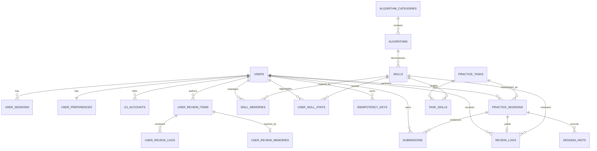

# MomoCode 数据库与领域模型（阶段 3）

| 项 | 内容 |
|---|---|
| 阶段 | 阶段 3：数据库与领域模型 |
| 版本 | v1.0 |
| 状态 | 待负责人确认，只设计不生成 ORM |
| 依据 | `docs/PRD.md` v1.0、`docs/ARCHITECTURE.md` v1.0 |
| 数据库 | PostgreSQL 14+（建议 16+） |
| 日期 | 2026-11-10 |

> 本文档定义字段、类型、约束、索引、关键查询与迁移策略。阶段 5/6 才创建实际模型与迁移文件。

---

## 1. 设计原则

1. **用户数据隔离**：所有用户拥有的表都带 `user_id`，查询必须显式限定当前用户。
2. **实体不合并**：Algorithm、Skill、PracticeTask 分表；Submission 不等于 PracticeSession。
3. **记忆与能力分离**：`skill_memories` 只存 FSRS 状态；`user_skill_stats` 只存可解释的 Skill Score 聚合。
4. **证据不可覆盖**：自动判题、OJ Verdict、提示记录分列保存；ReviewLog 不可变。
5. **内容可追溯**：算法/技能/任务使用软删除与内容版本；Session 保存任务快照，避免内容变更破坏历史。
6. **缺失值不臆造**：OJ 平台缺失字段为 `NULL`；未知 Verdict 不做“通过/失败”推断。
7. **避免过度抽象**：MVP 不使用多态表、EAV、事件溯源；训练答案用受 Pydantic 校验的 JSONB。
8. **时间统一 UTC**：数据库使用 `timestamptz`；用户时区只用于“今日/跨日”边界计算。
9. **枚举用 text + CHECK**：避免 PostgreSQL 原生 enum 的迁移锁定；值集合在应用层与 CHECK 双重约束。
10. **迁移优先**：所有结构变更通过 Alembic；种子内容与结构迁移分离。

---

## 2. ER 图



关系说明：

- Category 1—N Algorithm；Algorithm 1—N Skill。
- Task N—N Skill，通过 `task_skills`；识别任务的 `relation_type='target'` 技能集合即判分目标。
- Task 1—N Session；Session 0—N Submission（`submissions.session_id` 可空）。
- Session 0—1 ReviewLog；只有正式复习产生 ReviewLog，`session_id` 唯一。
- Skill 1—N SkillMemory；唯一键 `(user_id, skill_id)`。
- Skill 1—N UserSkillStats；唯一键 `(user_id, skill_id)`，是可重算聚合。
- UserReviewItem 1—0/1 UserReviewMemory；唯一键 `(user_id, item_id)`，与 SkillMemory 结构一致。
- UserReviewItem 1—N UserReviewLog；自定义内容每次评分产生一条不可变记录。

---

## 3. 通用约定

| 项 | 约定 |
|---|---|
| 主键 | 除 `skill_memories` 外使用 `uuid`（应用生成 `uuid4()`）；`skill_memories` 使用 `bigint identity` 作为 py-fsrs `Card.card_id`，见 4.10。 |
| 外键 | `ON DELETE` 按业务选择 CASCADE / RESTRICT / SET NULL，见各表。 |
| 时间 | `timestamptz`，默认 `now()`；应用写入 UTC。 |
| 软删除 | 内容表使用 `is_active boolean not null default true`；不物理删除被历史引用的内容。 |
| 审计 | 关键表含 `created_at`、`updated_at`；ReviewLog 只含 `created_at`，不可更新。 |
| 命名 | 表名复数 snake_case；索引 `ix_`、唯一 `uq_`、外键 `fk_`、检查 `ck_`。 |
| JSONB | 只用于结构多变的答案/证据/内容块；读写必须经 Pydantic 校验。 |
| 搜索 | MVP 用 `lower(name) LIKE` + btree；数据量增大后再评估 `pg_trgm`。 |

> 关于 `skill_memories.id`：py-fsrs 的 `Card.card_id` 是 `int`。为保持简单，`skill_memories` 使用 `bigint generated always as identity` 主键，并将其作为 `card_id`；`user_id + skill_id` 仍加唯一约束。其它表使用 UUID。此选择不影响对外 API（对外不暴露该 ID）。

---

## 4. 数据字典

### 4.1 users（用户）

| 列 | 类型 | 空 | 默认 | 约束/说明 |
|---|---|---|---|---|
| id | uuid | 否 |  | PK |
| email | text | 否 |  | 存储前转小写；唯一索引 `lower(email)` |
| password_hash | text | 否 |  | Argon2id 哈希；绝不返回前端 |
| display_name | text | 是 |  | 展示名，长度 1–80 |
| status | text | 否 | `'active'` | CHECK `status IN ('active','disabled')` |
| email_verified_at | timestamptz | 是 |  | 邮箱验证时间；Post-MVP 已启用 |
| last_login_at | timestamptz | 是 |  | 登录成功时更新 |
| created_at | timestamptz | 否 | `now()` |  |
| updated_at | timestamptz | 否 | `now()` |  |

索引：

- `uq_users_email_lower` UNIQUE (`lower(email)`)。
- `ix_users_status` (`status`)。

删除策略：MVP 不提供用户自删除；如后续实现，用户数据按 4.2–4.12 的 CASCADE/SET NULL 规则处理，并保留匿名化审计需求。

### 4.2 user_sessions（登录会话）

| 列 | 类型 | 空 | 默认 | 约束/说明 |
|---|---|---|---|---|
| id | uuid | 否 |  | PK |
| user_id | uuid | 否 |  | FK → users(id) ON DELETE CASCADE |
| token_hash | text | 否 |  | 会话令牌 SHA-256；唯一 |
| user_agent | text | 是 |  | 截断到 512 字符 |
| ip_hash | text | 是 |  | IP 哈希，避免明文存储 |
| expires_at | timestamptz | 否 |  | 滑动过期 |
| revoked_at | timestamptz | 是 |  | 登出/撤销 |
| created_at | timestamptz | 否 | `now()` |  |
| last_used_at | timestamptz | 是 |  |  |

索引：

- `uq_user_sessions_token_hash` UNIQUE (`token_hash`)。
- `ix_user_sessions_user_expires` (`user_id`, `expires_at`)。
- `ix_user_sessions_expires` (`expires_at`)。

### 4.3 user_preferences（用户偏好）

| 列 | 类型 | 空 | 默认 | 约束/说明 |
|---|---|---|---|---|
| user_id | uuid | 否 |  | PK，FK → users(id) ON DELETE CASCADE |
| timezone | text | 否 | `'UTC'` | IANA 时区名，应用校验 |
| daily_review_limit | integer | 否 | `50` | CHECK 1–500 |
| desired_retention | numeric(3,2) | 否 | `0.90` | CHECK 0.70–0.99；传给 FSRS |
| theme | text | 否 | `'dark'` | CHECK `('dark','light','system')` |
| locale | text | 否 | `'zh-CN'` |  |
| created_at | timestamptz | 否 | `now()` |  |
| updated_at | timestamptz | 否 | `now()` |  |

### 4.4 oj_accounts（OJ 账号）

| 列 | 类型 | 空 | 默认 | 约束/说明 |
|---|---|---|---|---|
| id | uuid | 否 |  | PK |
| user_id | uuid | 否 |  | FK → users(id) ON DELETE CASCADE |
| platform | text | 否 |  | CHECK `('codeforces','luogu','atcoder','other')` |
| handle | text | 否 |  | 平台账号标识 |
| display_name | text | 是 |  | 平台展示名 |
| credentials_encrypted | bytea | 是 |  | Post-MVP 同步用；MVP 为 NULL |
| is_active | boolean | 否 | `true` |  |
| created_at | timestamptz | 否 | `now()` |  |
| updated_at | timestamptz | 否 | `now()` |  |

索引：

- `uq_oj_accounts_user_platform_handle` UNIQUE (`user_id`, `platform`, `handle`)。
- `ix_oj_accounts_user` (`user_id`)。

安全：MVP 不要求用户提供 OJ 密码；只保存平台与 handle。未来同步凭据必须加密，密钥不入库。

### 4.5 algorithm_categories（算法分类）

| 列 | 类型 | 空 | 默认 | 约束/说明 |
|---|---|---|---|---|
| id | uuid | 否 |  | PK |
| slug | text | 否 |  | 唯一，URL 安全 |
| name | text | 否 |  |  |
| description | text | 是 |  |  |
| sort_order | integer | 否 | `0` |  |
| is_active | boolean | 否 | `true` |  |
| created_at | timestamptz | 否 | `now()` |  |
| updated_at | timestamptz | 否 | `now()` |  |

索引：`uq_algorithm_categories_slug` UNIQUE (`slug`)，`ix_algorithm_categories_sort` (`sort_order`)。

### 4.6 algorithms（算法）

| 列 | 类型 | 空 | 默认 | 约束/说明 |
|---|---|---|---|---|
| id | uuid | 否 |  | PK |
| category_id | uuid | 否 |  | FK → algorithm_categories(id) ON DELETE RESTRICT |
| slug | text | 否 |  | 唯一 |
| name | text | 否 |  |  |
| summary | text | 是 |  | 列表页摘要 |
| description_md | text | 是 |  | 详情页 Markdown |
| difficulty | smallint | 否 | `1` | CHECK 1–5 |
| prerequisites | jsonb | 否 | `'[]'` | 前置知识 slug/说明数组；导入时校验引用 |
| is_active | boolean | 否 | `true` |  |
| created_at | timestamptz | 否 | `now()` |  |
| updated_at | timestamptz | 否 | `now()` |  |

索引：`uq_algorithms_slug` UNIQUE (`slug`)，`ix_algorithms_category_sort` (`category_id`, `difficulty`)。

### 4.7 skills（技能）

| 列 | 类型 | 空 | 默认 | 约束/说明 |
|---|---|---|---|---|
| id | uuid | 否 |  | PK |
| algorithm_id | uuid | 否 |  | FK → algorithms(id) ON DELETE RESTRICT |
| slug | text | 否 |  | 唯一 |
| name | text | 否 |  |  |
| skill_type | text | 否 |  | CHECK `('recognition','base_implementation','variant','common_error')` |
| description_md | text | 是 |  |  |
| learning_objective | text | 是 |  |  |
| mastery_evidence_md | text | 是 |  | 什么证据算掌握 |
| common_mistakes_md | text | 是 |  | 易错点 |
| prerequisites | jsonb | 否 | `'[]'` | 前置技能/知识 |
| sort_order | integer | 否 | `0` |  |
| is_active | boolean | 否 | `true` |  |
| created_at | timestamptz | 否 | `now()` |  |
| updated_at | timestamptz | 否 | `now()` |  |

索引：

- `uq_skills_slug` UNIQUE (`slug`)。
- `ix_skills_algorithm_sort` (`algorithm_id`, `sort_order`)。
- `ix_skills_type_active` (`skill_type`, `is_active`)。

### 4.8 practice_tasks（训练任务）

| 列 | 类型 | 空 | 默认 | 约束/说明 |
|---|---|---|---|---|
| id | uuid | 否 |  | PK |
| slug | text | 否 |  | 唯一 |
| title | text | 否 |  |  |
| training_type | text | 否 |  | CHECK `('recognition','template','variant','correction')` |
| evaluation_mode | text | 否 |  | CHECK `('auto_recognition','self_assessment','auto_tests')` |
| difficulty | smallint | 否 | `1` | CHECK 1–5 |
| source_type | text | 否 | `'original'` | CHECK `('original','oj_reference','user')` |
| created_by_user_id | uuid | 是 |  | FK → users(id) ON DELETE SET NULL；非空时 `source_type='user'` |
| source_ref | text | 是 |  | OJ 题目引用；不编造 |
| oj_platform | text | 是 |  | CHECK 允许值或 NULL |
| oj_problem_ref | text | 是 |  | 平台题目 ID |
| oj_problem_url | text | 是 |  | 合法 URL；应用校验域名与协议 |
| statement_md | text | 否 |  | 题面/任务说明 |
| constraints_md | text | 是 |  | 数据范围/约束 |
| input_spec | jsonb | 是 |  | 答案输入结构说明 |
| expected_output_spec | jsonb | 是 |  | 期望输出结构说明 |
| code_scaffold | text | 是 |  | 模板/变体/纠错任务的起始代码 |
| reference_solution_md | text | 是 |  | 训练时隐藏；仅结果/复盘按规则展示 |
| language | text | 否 | `'cpp17'` | MVP 只承诺 C++17 |
| hints | jsonb | 否 | `'{}'` | 键为 1–5 级提示内容；识别任务只用 1–3 |
| max_hint_level | smallint | 否 | `5` | CHECK 0–5；识别任务为 3 |
| error_types | jsonb | 否 | `'[]'` | 纠错任务预设错误类型 |
| is_active | boolean | 否 | `true` |  |
| created_at | timestamptz | 否 | `now()` |  |
| updated_at | timestamptz | 否 | `now()` |  |

索引：

- `uq_practice_tasks_slug` UNIQUE (`slug`)。
- `ix_practice_tasks_filter` (`training_type`, `difficulty`, `is_active`)。
- `ix_practice_tasks_source` (`source_type`, `oj_platform`)。
- `ix_practice_tasks_creator` (`created_by_user_id`, `is_active`) —— 用户自建题目隔离与列表。

约束：

- `evaluation_mode='auto_recognition'` 仅允许 `training_type='recognition'`；`auto_tests` 编码任务必须在 `expected_output_spec.judge` 中提供测试用例（应用层 + CHECK）。
- 识别任务 `max_hint_level <= 3`；编码类任务 `max_hint_level` 可为 5。
- `oj_platform` 与 `oj_problem_ref` 同时为空或同时有值；`oj_problem_url` 若有值必须先有 `oj_platform`。
- `created_by_user_id IS NULL OR source_type='user'`：非空归属只允许用户自建题目。
- 用户自建题目只在本人目录、练习和到期队列可见；公共 `/catalog/tasks` 默认只返回种子内容。

### 4.9 task_skills（任务—技能关联）

| 列 | 类型 | 空 | 默认 | 约束/说明 |
|---|---|---|---|---|
| task_id | uuid | 否 |  | FK → practice_tasks(id) ON DELETE CASCADE |
| skill_id | uuid | 否 |  | FK → skills(id) ON DELETE CASCADE |
| relation_type | text | 否 | `'target'` | CHECK `('target','related')` |
| is_primary | boolean | 否 | `false` | 每个任务最多一个 primary（部分唯一索引） |
| created_at | timestamptz | 否 | `now()` |  |

主键：`PRIMARY KEY (task_id, skill_id)`。

索引：

- `ix_task_skills_skill` (`skill_id`, `relation_type`)。
- `uq_task_skills_primary` UNIQUE (`task_id`) WHERE `is_primary`。

规则：

- 每个任务至少一个 `target` 技能（应用层校验）。
- 识别任务的 `target` 技能集合是判分答案；编码类任务通常一个 `target` 技能。
- `related` 用于展示“相关技能”，不参与判分。

### 4.9.1 task_tags（题目标签）

| 列 | 类型 | 空 | 默认 | 约束/说明 |
|---|---|---|---|---|
| task_id | uuid | 否 |  | PK；FK → practice_tasks(id) ON DELETE CASCADE |
| tag | text | 否 |  | PK；最长 64；存储时去掉前导 `#` |
| created_at | timestamptz | 否 | `now()` |  |

索引：

- 主键 `(task_id, tag)`。
- `ix_task_tags_tag` (`tag`) —— 按标签检索。

规则：

- 标签是自由分类信息，与 `task_skills` 独立：`task_skills` 用于训练/评分关联，`task_tags` 用于 `#二分`、`#双指针`、`#BFS` 这类检索。
- 输入接受带 `#`、空格或逗号分隔的形式；服务层统一去 `#`、去重、截断到 32 字符、最多 12 个。
- 种子内容按目标技能自动生成算法标签；用户自建题目可自定义标签。
- 公共 `/catalog/tags` 只统计非用户题目；用户题目标签通过 `/user-tasks?tag=` 检索。

### 4.10 skill_memories（FSRS 记忆状态）

| 列 | 类型 | 空 | 默认 | 约束/说明 |
|---|---|---|---|---|
| id | bigint | 否 | identity | PK；作为 py-fsrs `Card.card_id` |
| user_id | uuid | 否 |  | FK → users(id) ON DELETE CASCADE |
| skill_id | uuid | 否 |  | FK → skills(id) ON DELETE RESTRICT |
| state | smallint | 否 | `1` | CHECK 1–3（Learning/Review/Relearning） |
| step | smallint | 是 |  | Learning/Relearning 步；Review 为 NULL |
| stability | double precision | 是 |  | FSRS 参数；不展示为能力分 |
| difficulty | double precision | 是 |  | FSRS 参数；不展示为能力分 |
| due_at | timestamptz | 否 | `now()` | 到期时间（UTC） |
| last_review_at | timestamptz | 是 |  | UTC |
| created_at | timestamptz | 否 | `now()` |  |
| updated_at | timestamptz | 否 | `now()` |  |

索引：

- `uq_skill_memories_user_skill` UNIQUE (`user_id`, `skill_id`)。
- `ix_skill_memories_due` (`user_id`, `due_at`) —— 到期队列核心索引。
- `ix_skill_memories_skill` (`skill_id`)。

规则：

- 首次完成某 Skill 的**正式复习**时创建初始 Card（`state=Learning`，`due_at=now()`）；自由练习默认不创建、不更新本表。
- 正式复习调用 py-fsrs 后更新本表；`difficulty`、`stability` 不进入 Analytics 的能力分。
- 自由练习标记为正式复习时，按正式复习流程创建/更新。
- 重置规则见待确认 Q14；若实现，重置 `state/step/stability/difficulty/due_at` 并写 ReviewLog 备注。

### 4.11 practice_sessions（训练会话）

| 列 | 类型 | 空 | 默认 | 约束/说明 |
|---|---|---|---|---|
| id | uuid | 否 |  | PK |
| user_id | uuid | 否 |  | FK → users(id) ON DELETE CASCADE |
| task_id | uuid | 否 |  | FK → practice_tasks(id) ON DELETE RESTRICT |
| task_snapshot | jsonb | 否 |  | 创建时的任务内容快照，保证历史可回放 |
| training_type | text | 否 |  | CHECK 四种训练类型；从任务快照冗余 |
| mode | text | 否 |  | CHECK `('review','free')` |
| status | text | 否 | `'created'` | CHECK `('created','in_progress','submitted','completed','abandoned')` |
| started_at | timestamptz | 是 |  | 第一次进入/开始 |
| submitted_at | timestamptz | 是 |  | 提交答案/代码 |
| completed_at | timestamptz | 是 |  | 结果确认完成 |
| time_spent_ms | integer | 是 |  | CHECK >= 0 |
| answer_payload | jsonb | 是 |  | 识别选择/代码/纠错结果；按训练类型校验 |
| auto_grade | jsonb | 是 |  | 自动判题结果：result、passed、total、score、cases、compile_output |
| draft_code | text | 是 |  | 未提交代码草稿；新 Session 为空 |
| draft_saved_at | timestamptz | 是 |  | 草稿最近保存时间 |
| self_assessment | text | 是 |  | 旧数据兼容；新编码提交不再写入 |
| self_assessment_note | text | 是 |  | 旧数据兼容 |
| max_hint_level | smallint | 否 | `0` | CHECK 0–5；由 hint 事件维护 |
| error_types | jsonb | 否 | `'[]'` | 用户选择/系统记录的错误类型 |
| mark_as_review | boolean | 否 | `false` | 自由练习是否显式标记正式复习 |
| created_at | timestamptz | 否 | `now()` |  |
| updated_at | timestamptz | 否 | `now()` |  |

索引：

- `ix_practice_sessions_user_created` (`user_id`, `created_at DESC`)。
- `ix_practice_sessions_user_status` (`user_id`, `status`)。
- `ix_practice_sessions_task` (`task_id`)。
- `ix_practice_sessions_user_type` (`user_id`, `training_type`, `created_at DESC`)。

约束：

- `completed_at >= started_at`（若两者非空）。
- `status='completed'` 时 `completed_at` 非空；`status='submitted'` 时 `submitted_at` 非空（应用层 + CHECK）。
- `mode='free'` 且 `mark_as_review=true` 时，完成后必须产生 ReviewLog（应用层事务保证）。

### 4.12 session_hints（提示事件）

| 列 | 类型 | 空 | 默认 | 约束/说明 |
|---|---|---|---|---|
| id | uuid | 否 |  | PK |
| session_id | uuid | 否 |  | FK → practice_sessions(id) ON DELETE CASCADE |
| level | smallint | 否 |  | CHECK 1–5 |
| content_snapshot | jsonb | 否 |  | 实际展示的提示内容快照 |
| requested_at | timestamptz | 否 | `now()` |  |

索引/约束：

- `uq_session_hints_session_level` UNIQUE (`session_id`, `level`)。
- `ix_session_hints_session` (`session_id`)。

规则：同一 Session 同一等级只记录一次；重复请求返回已展示内容，不重复计数。

### 4.13 submissions（提交证据）

| 列 | 类型 | 空 | 默认 | 约束/说明 |
|---|---|---|---|---|
| id | uuid | 否 |  | PK |
| user_id | uuid | 否 |  | FK → users(id) ON DELETE CASCADE |
| session_id | uuid | 是 |  | FK → practice_sessions(id) ON DELETE SET NULL；独立 Submission 为 NULL |
| oj_account_id | uuid | 是 |  | FK → oj_accounts(id) ON DELETE SET NULL |
| platform | text | 否 |  | CHECK 允许值；手动录入必填 |
| external_id | text | 是 |  | 平台提交 ID；手动关联建议必填 |
| problem_ref | text | 是 |  | 平台题目引用 |
| problem_url | text | 是 |  | 合法 URL |
| verdict | text | 是 |  | 统一 Verdict；未知为 NULL |
| verdict_raw | text | 是 |  | 平台原始 Verdict |
| language | text | 是 |  |  |
| time_ms | integer | 是 |  | CHECK >= 0 |
| memory_kb | integer | 是 |  | CHECK >= 0 |
| submitted_at | timestamptz | 是 |  | 平台提交时间；未知为 NULL |
| source | text | 否 | `'manual'` | CHECK `('manual','oj_sync')` |
| raw_payload | jsonb | 是 |  | 未来同步原始数据；MVP 可为 NULL |
| created_at | timestamptz | 否 | `now()` |  |

索引：

- `uq_submissions_user_platform_external` UNIQUE (`user_id`, `platform`, `external_id`) WHERE `external_id IS NOT NULL`。
- `ix_submissions_user_submitted` (`user_id`, `submitted_at DESC NULLS LAST`)。
- `ix_submissions_session` (`session_id`)。
- `ix_submissions_user_platform` (`user_id`, `platform`)。

规则：

- `source='oj_sync'` 时必须存在 `external_id`（应用层校验）。
- 平台缺失字段一律 NULL；不把未知 Verdict 写成 `accepted`。
- 一次 AC 不自动创建“掌握”状态；只作为 Review 映射的客观证据。

### 4.14 review_logs（正式复习记录）

| 列 | 类型 | 空 | 默认 | 约束/说明 |
|---|---|---|---|---|
| id | uuid | 否 |  | PK |
| user_id | uuid | 否 |  | FK → users(id) ON DELETE CASCADE |
| skill_id | uuid | 否 |  | FK → skills(id) ON DELETE RESTRICT |
| session_id | uuid | 是 |  | FK → practice_sessions(id) ON DELETE SET NULL；唯一 |
| rating | smallint | 否 |  | CHECK 1–4（Again/Hard/Good/Easy） |
| reviewed_at | timestamptz | 否 | `now()` | UTC；传给 py-fsrs 的 `review_datetime` |
| review_duration_ms | integer | 是 |  | CHECK >= 0 |
| scheduler_version | text | 否 |  | 如 `fsrs-6.3.2` |
| mapping_version | text | 否 |  | 证据→Rating 映射版本，如 `evidence-map-v1` |
| evidence_snapshot | jsonb | 否 |  | 当时的 Session 证据摘要，保留原始上下文 |
| created_at | timestamptz | 否 | `now()` |  |

索引/约束：

- `uq_review_logs_session` UNIQUE (`session_id`) WHERE `session_id IS NOT NULL` —— 防重复提交。
- `ix_review_logs_user_skill_time` (`user_id`, `skill_id`, `reviewed_at DESC`)。
- `ix_review_logs_user_time` (`user_id`, `reviewed_at DESC`)。

规则：

- ReviewLog 不可更新/删除；纠错通过新增记录或重置流程处理。
- 只有正式复习产生；自由练习未标记正式复习时不得写入。
- `evidence_snapshot` 保存当时证据，避免后续 Session 修改影响审计。

### 4.15 user_skill_stats（技能统计聚合）

| 列 | 类型 | 空 | 默认 | 约束/说明 |
|---|---|---|---|---|
| id | uuid | 否 |  | PK |
| user_id | uuid | 否 |  | FK → users(id) ON DELETE CASCADE |
| skill_id | uuid | 否 |  | FK → skills(id) ON DELETE RESTRICT |
| sample_size | integer | 否 | `0` | CHECK >= 0 |
| correctness_rate | numeric(5,4) | 是 |  | 0–1 |
| independence_score | numeric(5,4) | 是 |  | 0–1，提示依赖的反向指标 |
| hint_dependency | numeric(5,4) | 是 |  | 0–1 |
| avg_normalized_time | numeric(10,4) | 是 |  | 归一化耗时，不跨算法绝对比较 |
| error_distribution | jsonb | 否 | `'{}'` | 错误类型 → 次数 |
| skill_score | numeric(5,2) | 是 |  | 0–100；与 FSRS Difficulty 无关 |
| score_version | text | 否 | `'skill-score-v0'` | 公式版本 |
| insufficient_data | boolean | 否 | `true` | sample_size < 3 时为 true |
| computed_at | timestamptz | 否 | `now()` | 最近计算时间 |

索引/约束：

- `uq_user_skill_stats_user_skill` UNIQUE (`user_id`, `skill_id`)。
- `ix_user_skill_stats_user_score` (`user_id`, `skill_score DESC NULLS LAST`)。

规则：

- 本表是**可重算聚合**，不是事实来源；可由 Session/ReviewLog/Submission 重新生成。
- 不存储 FSRS `difficulty` 或 `stability`；两者不得混用。
- 样本不足时返回 `insufficient_data=true`，前端明确标注。

### 4.16 idempotency_keys（幂等键）

| 列 | 类型 | 空 | 默认 | 约束/说明 |
|---|---|---|---|---|
| id | uuid | 否 |  | PK |
| user_id | uuid | 否 |  | FK → users(id) ON DELETE CASCADE |
| endpoint | text | 否 |  | 如 `POST /sessions/{id}/complete` |
| key | text | 否 |  | 客户端 `Idempotency-Key` |
| request_hash | text | 否 |  | 请求体哈希，防止同键不同体 |
| response_status | integer | 是 |  | 首次结果快照 |
| response_body | jsonb | 是 |  | 首次结果快照 |
| created_at | timestamptz | 否 | `now()` |  |
| expires_at | timestamptz | 否 |  | 建议 24–72 小时 |

索引/约束：

- `uq_idempotency_user_endpoint_key` UNIQUE (`user_id`, `endpoint`, `key`)。
- `ix_idempotency_expires` (`expires_at`)。

### 4.17 content_versions（内容版本）

| 列 | 类型 | 空 | 默认 | 约束/说明 |
|---|---|---|---|---|
| id | uuid | 否 |  | PK |
| version | text | 否 |  | 唯一，如 `2026.11.2` |
| checksum | text | 否 |  | 种子内容哈希 |
| notes | text | 是 |  | 变更说明 |
| applied_at | timestamptz | 否 | `now()` |  |
| applied_by | text | 是 |  | 操作者/CI |

索引：`uq_content_versions_version` UNIQUE (`version`)。

---

### 4.18 email_tokens（邮箱验证/重置令牌）

| 列 | 类型 | 空 | 默认 | 约束/说明 |
|---|---|---|---|---|
| id | uuid | 否 |  | PK |
| user_id | uuid | 否 |  | FK users ON DELETE CASCADE |
| purpose | text | 否 |  | `verify_email` / `reset_password` |
| token_hash | text | 否 |  | SHA-256；唯一，不存原始 token |
| expires_at | timestamptz | 否 |  | 验证 24h / 重置 1h |
| used_at | timestamptz | 是 |  | 使用后写入，防重放 |
| created_at | timestamptz | 否 | `now()` |  |

索引：`ix_email_tokens_user_purpose` (`user_id`, `purpose`)、`ix_email_tokens_expires` (`expires_at`)。

---

### 4.19 user_review_items（用户自定义复习内容）

| 列 | 类型 | 空 | 默认 | 约束/说明 |
|---|---|---|---|---|
| id | uuid | 否 |  | PK |
| user_id | uuid | 否 |  | FK → users(id) ON DELETE CASCADE |
| title | text | 否 |  | 最长 200 |
| content_md | text | 否 |  | Markdown 内容；最长 20000 |
| tags | jsonb | 否 | `'[]'` | 字符串数组，去重、最多 20 个 |
| source_url | text | 是 |  | 可选来源链接；仅允许 http/https |
| is_active | boolean | 否 | `true` | 软删除；删除后不再进入到期队列 |
| created_at | timestamptz | 否 | `now()` |  |
| updated_at | timestamptz | 否 | `now()` |  |

索引：

- `ix_user_review_items_user_created` (`user_id`, `created_at DESC`)。
- `ix_user_review_items_user_active` (`user_id`, `is_active`)。

规则：

- 内容归用户所有，所有查询必须带 `user_id`。
- 创建时立即创建 `UserReviewMemory`（`state=Learning`、`due_at=now()`），因此会马上进入到期队列。
- `DELETE` 只做软删除，保留 `UserReviewLog` 历史；重新启用时若缺少记忆状态则补建。

### 4.20 user_review_memories（自定义内容 FSRS 状态）

| 列 | 类型 | 空 | 默认 | 约束/说明 |
|---|---|---|---|---|
| id | bigint | 否 | identity | PK；作为 py-fsrs `Card.card_id` |
| user_id | uuid | 否 |  | FK → users(id) ON DELETE CASCADE |
| item_id | uuid | 否 |  | FK → user_review_items(id) ON DELETE CASCADE |
| state | smallint | 否 | `1` | CHECK 1–3 |
| step | smallint | 是 |  | Learning/Relearning 步 |
| stability | double precision | 是 |  | 不展示为能力分 |
| difficulty | double precision | 是 |  | 不展示为能力分 |
| due_at | timestamptz | 否 | `now()` | 与 SkillMemory 共用到期队列 |
| last_review_at | timestamptz | 是 |  | UTC |
| created_at | timestamptz | 否 | `now()` |  |
| updated_at | timestamptz | 否 | `now()` |  |

索引/约束：

- `uq_user_review_memories_user_item` UNIQUE (`user_id`, `item_id`)。
- `ix_user_review_memories_due` (`user_id`, `due_at`) —— 自定义内容到期队列索引。
- `CHECK state BETWEEN 1 AND 3`。

### 4.21 user_review_logs（自定义内容复习记录）

| 列 | 类型 | 空 | 默认 | 约束/说明 |
|---|---|---|---|---|
| id | uuid | 否 |  | PK |
| user_id | uuid | 否 |  | FK → users(id) ON DELETE CASCADE |
| item_id | uuid | 否 |  | FK → user_review_items(id) ON DELETE CASCADE |
| rating | smallint | 否 |  | CHECK 1–4（Again/Hard/Good/Easy） |
| reviewed_at | timestamptz | 否 | `now()` | UTC |
| review_duration_ms | integer | 是 |  | CHECK >= 0 |
| scheduler_version | text | 否 |  | 如 `fsrs-6.3.2` |
| mapping_version | text | 否 |  | 固定 `custom-review-v1` |
| evidence_snapshot | jsonb | 否 |  | 内容标题、标签、来源等审计快照 |
| created_at | timestamptz | 否 | `now()` |  |

索引/约束：

- `ix_user_review_logs_user_time` (`user_id`, `reviewed_at DESC`)。
- `ix_user_review_logs_user_item_time` (`user_id`, `item_id`, `reviewed_at DESC`)。
- `CHECK rating BETWEEN 1 AND 4`；`review_duration_ms IS NULL OR >= 0`。

规则：

- 只追加、不更新/删除；与 `review_logs` 一样作为客观复习证据。
- 统计“今日已复习”时与 `review_logs` 合并计数。

---

## 5. 约束汇总

| 规则 | 实现 |
|---|---|
| 每个用户数据隔离 | 所有用户表含 `user_id`；repository 强制带当前用户 |
| Algorithm 1—N Skill | `skills.algorithm_id` FK |
| Task N—N Skill | `task_skills` 复合主键 |
| 每任务一个 primary 技能 | 部分唯一索引 `uq_task_skills_primary` |
| SkillMemory user×skill 唯一 | `uq_skill_memories_user_skill` |
| 一个 Session 最多一个 ReviewLog | 部分唯一索引 `uq_review_logs_session` |
| 一个 Session 多个 Submission | `submissions.session_id` 可空，多行 |
| 独立 Submission 允许 | `session_id` 可为 NULL |
| Submission 不重复 | 部分唯一索引 `(user_id, platform, external_id)` |
| 提示每级每 Session 一次 | `uq_session_hints_session_level` |
| Rating 仅 1–4 | CHECK |
| 提示等级 0–5 | CHECK |
| 难度 1–5 | CHECK |
| 用户时区/每日上限 | `user_preferences` + 应用校验 |
| 内容不可误删 | `is_active` 软删除 + FK RESTRICT |
| ReviewLog 不可变 | 不提供 UPDATE/DELETE API；审计保留 |
| 题目标签多对多 | `task_tags` 复合主键 + `ix_task_tags_tag` |
| 每用户每自定义内容一份 FSRS | `uq_user_review_memories_user_item` |
| 自定义内容软删除 | `user_review_items.is_active`；日志保留 |
| 自定义内容 Rating 仅 1–4 | CHECK |
| 自定义内容与技能共用到期队列 | `ix_user_review_memories_due` + 服务层合并排序 |

---

## 6. 索引与关键查询

### 6.1 到期队列

```sql
SELECT sm.id, sm.user_id, sm.skill_id, sm.due_at, s.name, s.slug
FROM skill_memories sm
JOIN skills s ON s.id = sm.skill_id
WHERE sm.user_id = :user_id
  AND sm.due_at <= :end_of_day_utc
ORDER BY sm.due_at ASC
LIMIT :daily_review_limit;
```

依赖索引：`ix_skill_memories_due (user_id, due_at)`。

> `:end_of_day_utc` 由用户时区换算得到；每日上限来自 `user_preferences.daily_review_limit`。

### 6.2 今日复习数量

```sql
SELECT count(*) AS due_count
FROM skill_memories
WHERE user_id = :user_id
  AND due_at <= :end_of_day_utc;
```

### 6.3 Session 结果摘要

```sql
SELECT ps.*,
       COALESCE(json_agg(sh.level ORDER BY sh.level) FILTER (WHERE sh.id IS NOT NULL), '[]') AS hint_levels,
       rl.rating, rl.reviewed_at
FROM practice_sessions ps
LEFT JOIN session_hints sh ON sh.session_id = ps.id
LEFT JOIN review_logs rl ON rl.session_id = ps.id
WHERE ps.id = :session_id AND ps.user_id = :user_id
GROUP BY ps.id, rl.rating, rl.reviewed_at;
```

### 6.4 按技能聚合证据

```sql
SELECT ps.training_type,
       count(*) AS attempts,
     avg(CASE WHEN ps.auto_grade->>'result' = 'correct' THEN 1 ELSE 0 END) AS auto_correct_rate,
       avg(ps.max_hint_level) AS avg_hint_level,
       avg(ps.time_spent_ms) AS avg_time_ms,
       count(*) FILTER (WHERE sub.verdict = 'accepted') AS accepted_submissions
FROM practice_sessions ps
LEFT JOIN submissions sub ON sub.session_id = ps.id
WHERE ps.user_id = :user_id
  AND ps.status = 'completed'
  AND ps.task_id IN (SELECT task_id FROM task_skills WHERE skill_id = :skill_id)
  AND ps.created_at >= :from_ts
GROUP BY ps.training_type;
```

> 实际统计会拆成多条查询，避免多表笛卡尔积；此处表达口径。

### 6.5 用户隔离检查

所有用户资源查询必须形如：

```sql
WHERE id = :resource_id AND user_id = :current_user_id
```

不允许先按 `id` 查再在应用层判断归属（避免时序/遗漏）。管理员接口不在 MVP。

---

## 7. 实时计算、缓存与持久化统计

| 数据 | 方式 | 说明 |
|---|---|---|
| Session 状态、答案、提示 | PostgreSQL 实时读写 | 事实来源 |
| 到期队列 | PostgreSQL 实时查询 + 索引 | 每次进入复习页查询 |
| Dashboard 摘要 | Redis 短期缓存（约 60s）+ 回源 | 允许短暂过期；不得用假数据 |
| Skill Score | `user_skill_stats` 持久化聚合 | 由 Skill Engine 重算；可回放 |
| Analytics 时间序列 | 读时聚合 | MVP 数据量下可行 |
| 登录限流 | Redis | 短期计数；不作为审计事实 |
| 幂等键 | PostgreSQL | 需跨请求持久化；定期清理过期键 |

---

## 8. 迁移策略

1. 使用 Alembic；迁移文件命名 `YYYYMMDD_short_description.py`。
2. 每个迁移只做一类逻辑变更；结构变更与种子数据分离。
3. 生产迁移前必须备份；破坏性变更（删列/改类型）先加新列、回填、再删旧列。
4. 使用 `alembic upgrade head` 部署；回滚用 `alembic downgrade -1`（仅开发/紧急）。
5. 种子内容通过 `scripts/seed_content.py` 导入，写入 `content_versions`；导入幂等（按 slug upsert）。
6. 不在迁移中调用外部服务；不在迁移中写入真实用户数据。
7. 索引创建使用 `CREATE INDEX CONCURRENTLY`（生产大表；需在事务外执行，Alembic 配置 `transaction_per_migration` 时注意）。
8. 所有 `timestamptz` 写入 UTC；数据库时区设为 UTC。
9. 初期 PostgreSQL 版本要求 14+（`gen_random_uuid()`、部分索引、JSONB）；建议 16+。

---

## 9. 示例数据

### 9.1 分类与算法

```json
{
  "category": {"slug": "basics", "name": "基础算法", "sort_order": 10},
  "algorithm": {
    "slug": "binary-search",
    "name": "二分查找",
    "category_slug": "basics",
    "difficulty": 1,
    "summary": "在有序区间中通过折半缩小搜索范围。",
    "prerequisites": []
  }
}
```

### 9.2 技能

```json
[
  {
    "slug": "binary-search-recognition",
    "algorithm_slug": "binary-search",
    "name": "识别二分查找适用场景",
    "skill_type": "recognition",
    "learning_objective": "根据单调性与数据范围判断是否可用二分。",
    "mastery_evidence_md": "在识别任务中连续正确且提示等级 ≤1。",
    "common_mistakes_md": "忽略单调性；边界写成闭/开区间不一致。"
  },
  {
    "slug": "binary-search-template",
    "algorithm_slug": "binary-search",
    "name": "独立复现二分模板",
    "skill_type": "base_implementation",
    "learning_objective": "不看参考代码写出 lower_bound 模板。",
    "mastery_evidence_md": "无提示或仅 1 级提示下通过内置测试，或关联 OJ AC。",
    "common_mistakes_md": "mid 溢出；l/r 更新导致死循环；返回值差一。"
  }
]
```

### 9.3 训练任务

```json
{
  "slug": "binary-search-recognition-001",
  "title": "识别：有序数组查找目标值",
  "training_type": "recognition",
  "evaluation_mode": "auto_recognition",
  "difficulty": 1,
  "source_type": "original",
  "statement_md": "给定升序数组与目标值，判断是否存在目标值。请选择最合适的算法。",
  "constraints_md": "1 ≤ n ≤ 1e5；数组严格升序。",
  "max_hint_level": 3,
  "hints": {
    "1": "考虑有序性带来的搜索空间缩减。",
    "2": "每次比较中间元素可以排除一半区间。",
    "3": "维护左右边界，注意区间开闭与终止条件。"
  },
  "target_skills": ["binary-search-recognition"]
}
```

### 9.4 Session 与 ReviewLog

```json
{
  "session": {
    "mode": "review",
    "status": "completed",
    "training_type": "template",
    "answer_payload": {"code": "..."},
    "auto_grade": {"result": "correct", "passed": 2, "total": 2, "score": 1.0},
    "max_hint_level": 0,
    "time_spent_ms": 42000
  },
  "review_log": {
    "rating": 4,
    "scheduler_version": "fsrs-6.3.2",
    "mapping_version": "evidence-map-v1",
    "reviewed_at": "2026-11-10T12:00:00Z"
  }
}
```

---

## 10. 待确认事项

1. **Q10 Skill 拆分粒度**：每算法 4 类技能是否固定？首批任务数量？影响种子数据量，不影响表结构。
2. **Q14 复习重置**：是否允许用户重置单个 Skill；若允许，重置是否写 ReviewLog 备注、是否保留历史。
3. **用户删除策略**：MVP 无自删除；未来是级联删除还是匿名化保留统计。
4. **内容软删除**：MVP 使用 `is_active`；是否需要内容版本回滚到具体历史版本（当前只记录版本应用）。
5. **OJ 凭据存储**：Post-MVP 同步需要加密方案（KMS/应用层 Fernet）；MVP 不存密码。
6. **搜索能力**：当前 37 个算法用 ILIKE 足够；内容继续扩大后再评估 `pg_trgm` 或全文检索。
7. **ReviewLog evidence_snapshot 大小**：需限制 JSONB 体积（建议 < 32 KB），避免审计数据膨胀。
8. **Skill Score 重算频率**：Session 完成时同步重算，还是后台批量重算；阶段 12 确认。
9. **时区数据**：使用 IANA 时区名；应用用 `zoneinfo` 校验，数据库只存字符串。
10. **PostgreSQL 版本**：部署环境最低 14，建议 16；阶段 14 确认。

---

## 11. 与架构/PRD 的对应关系

| PRD 要求 | 数据库落点 |
|---|---|
| 用户数据隔离 | 所有用户表 `user_id` + 查询强制作用域 |
| Algorithm/Skill/Task 不同实体 | `algorithms`、`skills`、`practice_tasks` |
| 一算法多技能 | `skills.algorithm_id` |
| Task 多技能 | `task_skills` |
| 每用户每技能独立 FSRS | `skill_memories` 唯一 `(user_id, skill_id)` |
| 一次 AC 不等于掌握 | `submissions.verdict` 仅证据；`skill_memories` 由 ReviewLog 更新 |
| 内置判题与 OJ 证据分离 | `practice_sessions.auto_grade`、`submissions.verdict` |
| 提示记录 | `session_hints` + `practice_sessions.max_hint_level` |
| 自由练习默认不更新 FSRS | `practice_sessions.mode/mark_as_review` + 事务规则 |
| OJ 缺失字段 null | `submissions` 可空字段 |
| Skill Score ≠ FSRS Difficulty | `user_skill_stats.skill_score` vs `skill_memories.difficulty` |
| 正式复习幂等 | `uq_review_logs_session` + `idempotency_keys` |
| 到期队列 | `ix_skill_memories_due` |
