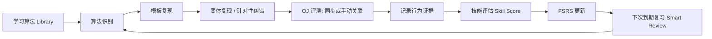
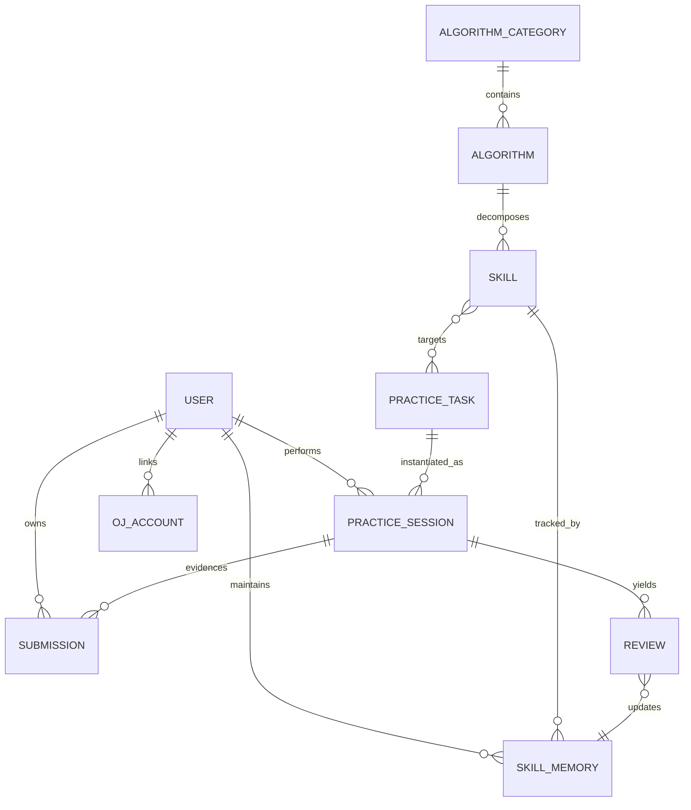

# MomoCode 产品需求文档（PRD）

| 项 | 内容 |
|---|---|
| 阶段 | 阶段 1：需求分析与 PRD |
| 版本 | v1.0（已确认基线） |
| 状态 | 已确认，可进入架构阶段 |
| 最后更新 | 2026-11-10 |
| 确认记录 | 2026-11-10 确认认证范围、判定方式、OJ 范围、Skill Score 等关键决策 |
| 产品形态 | Web-first，Desktop-ready |
| 依据 | `00_PROJECT_CONTEXT.md`、`prompts/01_REQUIREMENTS_PRD.md` |
| 范围约束 | 本阶段只产出需求，不写代码，不设计数据库字段 |

> 说明：本文档描述“做什么、为什么做、如何验收”，不涉及技术实现与数据模型细节。所有涉及外部 OJ、判题与第三方能力的表述，均以“待验证/待确认”标注，不做能力假设。
>
> Post-MVP 更新（2026-11-11）：邮箱验证、找回密码、密码修改、活跃会话、JSON 数据导出、主题偏好同步与 Codeforces 手动同步已实现。下文标注的“MVP 不做”仍表示最初 MVP 基线，不代表当前代码状态。

---

## 1. 产品概述

### 1.1 产品定位

MomoCode 是一个**算法识别与代码模板肌肉记忆训练平台**。它不追求“做题数量”，而是帮助用户：

- 长期记住算法与代码模板；
- 识别算法适用场景（看题知算法）；
- 不看参考代码独立复现模板；
- 掌握算法变体；
- 针对薄弱点与常见错误纠错。

一句话：把“做过题”训练成“真正掌握”。

### 1.2 目标用户

MVP 聚焦个人学习者，按优先级：

1. **算法竞赛选手**（Codeforces / 洛谷 / AtCoder 方向）。
2. **准备技术面试的开发者**。
3. **系统性自学算法的学习者**。

> MVP 采用**多用户邮箱密码认证**，用户数据严格隔离（详见第 7 节与第 12 节验收标准）。认证层预留 GitHub/Google 等第三方登录扩展点，但 MVP 不实现第三方登录、邮箱验证与找回密码。

### 1.3 用户痛点

- 刷了很多题，但过一段时间就忘，考点靠临时记忆。
- 会做某道题，却**认不出**它属于什么算法、为什么用这个算法。
- 模板记不牢，考场上写不出、写不全。
- 题目稍有变体就不会迁移。
- 复习没有计划，凭感觉重复刷已会的题。
- 错误反复发生，但说不清错在哪类（边界、初始化、溢出、越界、逻辑）。

### 1.4 产品价值

通过“**识别 → 复现 → 变体 → 纠错**”四类训练，配合**基于证据的技能评估**与 **FSRS 间隔复习**，把模糊的“好像会了”转化为可追溯、可调度的掌握状态。

### 1.5 核心闭环

```
学习算法 → 算法识别 → 模板复现 → 变体/纠错 → OJ 评测
   → 记录行为证据 → 技能评估 → FSRS 更新 → 下次复习
```

### 1.6 用户场景

- 每天打开 Dashboard，查看今日复习量与训练入口。
- 在 Algorithm Library 浏览/检索算法与技能，进入学习或训练。
- 在 Smart Review 中按 FSRS 到期队列完成正式复习。
- 在 Free Practice 中自由选题练习。
- 在 Practice Workspace 中完成识别 / 编码 / 纠错任务，使用分级提示并计时。
- 将 OJ 提交（同步或手动关联）作为评测证据。
- 在 Analytics 中查看训练表现与复习状态。

---

## 2. 产品目标与成功指标

### 2.1 产品目标

| 编号 | 目标 |
|---|---|
| G1 | 帮助用户长期记住算法模板（间隔复习驱动）。 |
| G2 | 提升“看题识别算法”的能力。 |
| G3 | 提升独立复现与变体迁移能力。 |
| G4 | 用可解释的证据评估技能，而非用单次 AC 代替掌握。 |
| G5 | 打通 OJ 评测闭环，至少支持手动关联兜底。 |

### 2.2 成功指标（MVP 验证目标，非对外承诺 KPI）

- 用户能完整走通四类训练，并产生可追溯的训练/复习记录。
- 每次正式复习都能更新对应 Skill 的记忆状态。
- 自由练习默认不污染记忆状态。
- 证据记录完整（正确性、独立程度、提示等级、耗时、错误类型、变体表现）。
- 提示依赖呈下降趋势、独立完成比例上升（趋势观察，非绝对阈值）。

---

## 3. 术语与核心实体（概念层，不含字段）

> 本阶段只定义“是什么、彼此关系”，不定义数据库字段与类型。

| 概念 | 含义 |
|---|---|
| **Algorithm（算法）** | 一个可学习的算法单元，如“二分查找”。 |
| **AlgorithmCategory（算法分类）** | 算法的归类，如基础、图论、动态规划。 |
| **Skill（技能）** | 算法可拆分的独立训练能力单元。一个 Algorithm 可拆为多个 Skill（如识别、基础实现、重要变体、常见错误）。用户对每个 Skill 独立维护记忆状态。 |
| **PracticeTask（训练任务）** | 绑定明确 Skill、训练类型、输入材料、评测方式与提示等级的任务。**任务必须训练明确技能。** |
| **PracticeSession（训练会话）** | 用户对某任务的一次完整训练过程：开始/结束、作答、提示使用、耗时、完成状态。 |
| **Submission（提交）** | 一次代码提交/评测证据，可来自 OJ（同步）或手动关联。**Submission ≠ PracticeSession。** |
| **Review（复习记录）** | 一次**正式复习**的反馈记录，驱动 FSRS 更新。 |
| **SkillMemory（技能记忆状态）** | 每个用户 × 每个 Skill 独立维护的 FSRS 记忆状态。 |
| **Skill Score（技能分数）** | 综合性的技能评估分数，用于表达能力水平。 |
| **FSRS Difficulty（FSRS 难度）** | FSRS 内部参数，**不是**能力分数，二者不得混用。 |
| **Evidence（证据）** | 正确性、独立程度、提示等级、耗时、错误类型、变体表现、OJ Verdict 等可记录的行为证据。 |

**关键区分**：

- Algorithm、Skill、PracticeTask 是**不同实体**，不可合并。
- Skill Score ≠ FSRS Difficulty。
- 一次 AC ≠ 掌握；WA 也不一定代表遗忘。

---

## 4. 功能范围与模块职责

MVP 包含以下 8 个模块，每个模块职责明确、避免重叠。

### 4.1 Dashboard（概览）
- 今日待复习数量与入口。
- 训练入口（四类训练）。
- 近期表现摘要与复习状态摘要。
- 不承担训练执行与统计口径定义。

### 4.2 Algorithm Library（算法库）
- 按 Category / Algorithm / Skill 浏览与检索。
- 展示算法/技能的目标、前置知识、掌握证据、易错点。
- 从算法/技能进入对应训练。
- 只负责内容组织与导航，不负责复习调度。

### 4.3 Smart Review（智能复习 / 自动复习）
- 依据 FSRS 到期队列生成今日复习任务。
- 复习时**默认隐藏完整答案与模板**。
- 完成后产生正式复习反馈并更新对应 Skill 的 FSRS 状态。

### 4.4 Free Practice（自由练习）
- 用户自由选择算法/任务练习，不受 FSRS 调度限制。
- **默认不更新 FSRS**；仅当用户明确标记“作为正式复习”时才更新。

### 4.5 Practice Workspace（训练工作区）
- 任务说明、代码区（Monaco）或 OJ 跳转、分级提示、计时、提交状态。
- 承载四类训练的执行过程与证据采集。
- 结果页展示结果摘要，不承担统计聚合。

### 4.6 OJ Integration（OJ 集成）
- OJ 账号关联（安全存储，前端不暴露凭据）。
- 提交同步（平台支持时）与**手动关联兜底**。
- Verdict / 时间 / 内存 / 语言等归一化映射；平台缺失字段保留 null。
- 不开发判题服务器；OJ Verdict 仅作为证据，不直接等同掌握。

### 4.7 Analytics（学习分析）
- 定义指标含义、公式、来源与时间范围。
- 区分四类训练分别统计。
- 按任务类型与难度归一化耗时；展示错误、提示、独立完成比例与复习状态。
- 处理样本不足并明确标注；初版 Skill Score 纳入 MVP，与 FSRS Difficulty 分开展示。
- 不把 FSRS Difficulty 当能力分，不凭单次结果下结论。

### 4.8 Settings（设置）
- 账号与安全、OJ 账号关联、复习偏好、时区等。
- 不承担训练与统计逻辑。

---

## 5. 四类训练

> 通用说明：
> - **提示等级（0–5）**：0 无提示；1 算法类别；2 核心思想；3 数据结构/状态；4 部分代码；5 完整参考实现。
> - 每次训练记录：正确性、独立程度、最高提示等级及每级提示使用、耗时、错误类型、（适用时）变体表现。
> - **内置自动判题与 OJ 证据分离记录**：系统运行内置测试用例的结果与 OJ 提交结果分列，不相互覆盖。
> - 编码任务以“内置测试用例通过情况”为主要正确性来源，OJ verdict 作为可选外部证据。

### 5.1 算法识别（Recognition）

| 项 | 内容 |
|---|---|
| 目的 | 根据题意、数据范围、约束与复杂度判断适用算法。 |
| 输入 | 题面（题目描述、约束、数据范围）；可来自 OJ 引用或内置识别题。 |
| 流程 | 展示题面 → 用户从算法库选择/填写合适算法（可多选）→ 可申请 0–3 级提示 → 提交 → 系统按目标算法集合自动判分 → 记录证据。 |
| 输出/证据 | 选择正确性（正确/部分正确/错误）、提示等级、耗时、错误类型（如误判复杂度、忽略约束）。 |
| 完成条件 | 用户提交识别答案。 |
| 判定 | 系统自动判分：与目标算法集合完全一致为正确；有重叠但不一致为部分正确；无重叠为错误。识别训练仅启用 0–3 级提示，不提供部分/完整代码。 |

### 5.2 模板复现（Template Reproduction）

| 项 | 内容 |
|---|---|
| 目的 | 不看参考代码，独立实现基础模板。 |
| 输入 | 算法/技能说明、目标语言、代码区（可带脚手架）、任务要求；参考实现隐藏。 |
| 流程 | 展示任务（隐藏参考实现）→ 用户在 Monaco 编写代码 → 可申请 0–5 级提示 → 提交 → 系统编译运行内置测试用例并判分，可选关联 OJ 提交 → 记录证据。 |
| 输出/证据 | 代码、内置测试用例通过情况、OJ 证据（可选）、独立程度、提示等级、耗时、错误类型。 |
| 完成条件 | 提交代码并完成自动判题（可附 OJ 提交关联）。 |
| 判定 | 内置判题结果与 OJ 证据分离记录；正确性 + 独立程度 + 提示等级综合；不得仅以单次 AC 判定掌握。 |

### 5.3 变体复现（Variant Reproduction）

| 项 | 内容 |
|---|---|
| 目的 | 完成算法变化（如路径恢复、区间修改等变体）。 |
| 输入 | 变体任务描述、基础模板（可选）、目标变体要求、评测方式。 |
| 流程 | 展示变体任务 → 用户实现 → 可申请 0–5 级提示 → 提交 → 系统自动判题，可选关联 OJ 提交 → 记录变体表现。 |
| 输出/证据 | 变体内置测试通过情况、OJ 证据（可选）、独立程度、提示等级、耗时、错误类型、相对基础模板的偏差表现。 |
| 完成条件 | 提交变体实现并完成自动判题（可附 OJ 提交关联）。 |
| 判定 | 同模板复现，并单独记录变体维度证据。 |

### 5.4 针对性纠错（Targeted Correction）

| 项 | 内容 |
|---|---|
| 目的 | 训练边界、初始化、溢出、越界、逻辑错误等薄弱点。 |
| 输入 | 含已知缺陷或易错点的代码/任务；错误类型标签。 |
| 流程 | 展示任务 → 用户定位并修复错误 → 可申请 0–5 级提示 → 提交 → 系统用模板测试 main 包装后自动判题，可选关联 OJ 提交 → 记录错误类型证据。 |
| 输出/证据 | 修复后的内置测试通过情况、OJ 证据（可选）、错误类型、提示等级、耗时。 |
| 完成条件 | 提交纠错结果并完成自动判题（可附 OJ 提交关联）。 |
| 判定 | 错误定位 + 修复结果综合；错误类型用于后续薄弱点训练。 |

---

## 6. 自动复习与自由练习的区别

| 维度 | Smart Review（自动复习） | Free Practice（自由练习） |
|---|---|---|
| 任务来源 | FSRS 到期队列（user × skill） | 用户自选算法/任务 |
| 是否受调度 | 是 | 否 |
| 答案/模板可见性 | 默认隐藏完整答案与模板 | 用户可自行查看（不强制隐藏） |
| 是否更新 FSRS | **是**（正式复习） | **默认否**；用户明确标记“作为正式复习”才更新 |
| 目标 | 巩固到期技能、维持记忆 | 探索、查漏、兴趣驱动练习 |

规则要点：自由练习若被标记为正式复习，则按正式复习流程产生 Review 记录并更新对应 Skill 的 FSRS；未标记时只产生 Session/证据，不改变记忆状态。

---

## 7. 业务规则（MVP 核心规则）

| 编号 | 规则 |
|---|---|
| R1 | Algorithm、Skill、PracticeTask 是不同实体，不可互相替代。 |
| R2 | 一个 Algorithm 可拆为多个独立 Skill。 |
| R3 | 每个用户 × 每个 Skill 独立维护 FSRS 状态。 |
| R4 | FSRS 负责复习调度，**不代表综合技能分数**。 |
| R5 | Skill Score 与 FSRS Difficulty 不得混为一谈。 |
| R6 | 一次 AC 不等于掌握；WA 也不一定代表遗忘。 |
| R7 | 必须记录：正确性、独立程度、提示等级、耗时、错误类型、变体表现。 |
| R8 | 不同算法耗时不能直接绝对比较；需结合任务难度与个人历史基准归一化。 |
| R9 | 自由练习默认不更新 FSRS；仅明确标记为正式复习时更新。 |
| R10 | 提示等级分为 0–5 级（见第 5 节）。 |
| R11 | 使用受限判题容器运行内置测试用例；不做完整 OJ 判题服务；OJ Verdict 仍作为独立外部证据。 |
| R12 | 内置判题结果与 OJ 证据分离记录，不相互覆盖。 |
| R13 | 每个 PracticeTask 必须训练明确技能。 |
| R14 | 用户数据必须隔离；对认证、密钥与用户数据采用保守安全默认值。 |
| R15 | 复习默认隐藏完整答案与模板。 |
| R16 | OJ 不可用时，训练记录仍必须可保存与回放。 |
| R17 | 正式复习的重复提交需防重/幂等，避免重复影响 FSRS。 |
| R18 | OJ 平台缺失字段保留 null，不臆造数据。 |
| R19 | 复杂算法应拆为独立技能，避免一个技能混杂多种能力。 |
| R20 | 原创内容、OJ 引用与用户内容需区分，遵守许可与平台条款。 |
| R21 | MVP 采用多用户邮箱密码认证；预留第三方登录扩展，不实现邮箱验证与找回密码。 |
| R22 | 识别训练由系统自动判分；编码类训练由内置测试用例自动判题，OJ 关联作为可选外部证据。 |
| R23 | MVP 的 OJ 能力仅包含手动关联与题目跳转，不实现提交同步；Adapter 接口预留。 |
| R24 | MVP 包含基础 Skill Score，但必须与 FSRS Difficulty 分开展示。 |
| R25 | 每日复习上限默认 50，可配置；跨日边界以用户时区为准。 |
| R26 | 一个 Session 可关联 0..N 个 Submission；允许独立 Submission，但未关联 Session 的不作为训练证据。 |
| R27 | MVP 不做提醒/通知与数据导出；桌面端仅保留架构扩展点。 |

---

## 8. 用户流程

### 8.1 主流程（核心闭环）



### 8.2 关键场景流程

- **首次使用**：注册/登录 → 基础引导（可选选择目标与感兴趣算法）→ Dashboard。
- **学习与训练**：Algorithm Library → 选择 Algorithm → 查看 Skill → 选择训练类型 → Practice Workspace → 完成任务 → 结果摘要。
- **自动复习**：Dashboard / Smart Review → 到期队列 → 隐藏答案训练 → 提交 → FSRS 更新 → 下次到期。
- **自由练习**：Free Practice → 自选算法/任务 → 训练 → 默认不更新 FSRS（可显式标记正式复习）。
- **OJ 关联**：Settings 关联 OJ 账号 → 训练页跳转 OJ 或手动录入/关联提交 → Submission 关联到 Session。
- **分析**：Analytics 查看指标与复习状态。

---

## 9. 实体业务关系（概念层）



关系规则（概念）：

- Category 1—N Algorithm；Algorithm 1—N Skill。
- Skill N—N PracticeTask（一个任务可测多技能，但必须明确目标技能）。
- PracticeTask 1—N PracticeSession。
- PracticeSession 与 Submission 关联；Submission 可来自 OJ 或手动，**Submission 不等于 Session**。
- Review 由正式复习产生，关联 Session/Skill，并驱动 SkillMemory 的 FSRS 更新。
- SkillMemory 以 user × skill 为唯一维护单位。

> 具体字段、约束、索引留待阶段 3（数据库设计），本阶段不定义。

---

## 10. 范围划分

### 10.1 MVP 范围（必须）

- 多用户邮箱密码认证与用户数据隔离（预留第三方登录扩展）。
- 算法与技能库（Category / Algorithm / Skill），含 10 个初始算法：二分查找、双指针、前缀和、差分、BFS、DFS、Dijkstra、并查集、01 背包、LIS。
- 四类训练：算法识别、模板复现、变体复现、针对性纠错。
- 训练会话与提示记录（Session 生命周期、分级提示、计时、自动判题与 OJ 证据分离、错误类型）。
- FSRS：skill 级记忆状态、到期队列、正式复习更新、自由练习不更新。
- 自由练习（默认不更新 FSRS，可标记正式复习）。
- 基础统计与 Analytics 初版（含基础 Skill Score）。
- OJ 手动关联与题目跳转（不实现提交同步；Adapter 接口预留）。
- Dashboard、Algorithm Library、Practice Workspace、Practice Result、Settings 页面。

### 10.2 后续版本（Post-MVP，不阻塞 MVP）

- Codeforces 提交同步与更多 OJ（洛谷、AtCoder；须先验证 API、限流与条款）。
- 更成熟的 Skill Score 模型与个性化推荐。
- 更丰富的内容/变体库与内容导入工具。
- 邮箱验证、找回密码、GitHub/Google 第三方登录。
- 提醒/通知（如复习提醒）。
- 高级 Analytics（趋势对比、个人基准、导出）。
- 编辑器与多语言增强（MVP 仅承诺 C++17）。

### 10.3 暂不考虑（MVP 明确非目标）

- 会员/付费体系。
- 组队、社交、排行榜、评论等社交功能。
- 桌面端应用（MVP 只做 Web；架构可 Desktop-ready，但不实现桌面端）。
- 自建在线判题服务器。
- 原生移动端 App。
- 公开题库市场 / UGC 平台化。
- 实时多人协作。

---

## 11. 用户故事（MVP）

> 格式：作为<角色>，我希望<目标>，以便<价值>。

**认证与设置**
- US-01 作为新用户，我希望注册/登录，以便保存我的学习数据。
- US-02 作为用户，我希望我的数据仅自己可见，以便安全使用。
- US-03 作为用户，我希望关联 OJ 账号并手动关联提交，以便把 OJ 结果作为证据。
- US-04 作为用户，我希望设置复习偏好与时区，以便复习符合我的作息。

**算法库**
- US-05 作为用户，我希望浏览与检索算法/技能，以便找到要学的内容。
- US-06 作为用户，我希望查看技能的掌握证据与易错点，以便有目标地练习。

**四类训练**
- US-07 作为用户，我希望做算法识别训练，以便提升看题选算法的能力。
- US-08 作为用户，我希望做模板复现训练，以便脱离参考代码独立写出模板。
- US-09 作为用户，我希望做变体复现训练，以便掌握算法变化。
- US-10 作为用户，我希望做针对性纠错训练，以便改掉重复错误。
- US-11 作为用户，我希望使用分级提示并记录，以便了解自己的独立程度。

**复习与练习**
- US-12 作为用户，我希望看到今日到期复习并按计划复习，以便长期记忆。
- US-13 作为用户，我希望复习时默认隐藏答案，以便真实检验记忆。
- US-14 作为用户，我希望自由练习不影响我的复习进度，以便放心探索。
- US-15 作为用户，我希望把某次自由练习标记为正式复习，以便计入记忆更新。

**OJ 与证据**
- US-16 作为用户，我希望从训练跳转到 OJ 或手动关联提交，以便获得评测证据。
- US-17 作为用户，我希望 OJ 不可用时训练仍能保存，以便不丢失记录。

**分析**
- US-18 作为用户，我希望看到区分训练类型的表现与复习状态，以便了解薄弱点。
- US-19 作为用户，我希望指标有明确口径，以便信任分析结果。

---

## 12. MVP 验收标准

> 每条力求“可理解、可验收”。判定以真实操作结果为准。

**MVP 范围与验收对照**

| MVP 范围项（见 10.1） | 验收标准 |
|---|---|
| 用户基础认证与用户数据隔离 | 12.1 |
| 算法与技能库 | 12.2 |
| 四类训练 | 12.3 |
| 训练会话与提示记录 | 12.3、12.4 |
| FSRS | 12.5 |
| 自由练习 | 12.5、12.10 |
| Dashboard 与复习 | 12.6 |
| 首个 OJ 集成 / 手动关联 | 12.7 |
| 基础统计与 Analytics 初版 | 12.8 |
| Settings | 12.9 |
| Practice Result | 12.11 |

### 12.1 认证与数据隔离
- [ ] 用户可注册、登录、登出；未登录访问受保护页面被拒绝。
- [ ] 用户 A 无法读取/修改用户 B 的会话、提交、复习与统计。
- [ ] 密钥不明文暴露于前端或日志。

### 12.2 算法库
- [ ] 可浏览 Category → Algorithm → Skill，并可检索。
- [ ] 10 个初始算法均有内容；至少 3 个代表性算法（基础/图论/DP）有完整技能拆分与训练样例。
- [ ] 技能详情展示目标、前置、掌握证据、易错点。

### 12.3 四类训练
- [ ] 四类训练均可从 Library / Free Practice / Smart Review 进入并完成。
- [ ] 识别训练：提交后按目标算法判定并记录结果。
- [ ] 模板复现：可编码、可提交、得到内置测试自动判题结论并记录。
- [ ] 变体复现：可完成并单独记录变体表现。
- [ ] 针对性纠错：可提交定位与修复结果，并记录错误类型。
- [ ] 每类训练都记录：正确性、独立程度、最高提示等级、耗时、错误类型。
- [ ] 任务必须关联明确 Skill，Session 与 Skill 关联正确。

### 12.4 提示与证据
- [ ] 提示分为 0–5 级，记录每级提示的使用与最高等级。
- [ ] 内置判题与 OJ 证据分开保存，互不覆盖。
- [ ] 非法状态转换（如未开始即结束、结束后再提交）被拒绝。

### 12.5 FSRS
- [ ] 首次正式复习可建立 user × skill 初始记忆状态；自由练习默认不建立。
- [ ] 正式复习更新对应 Skill 的 FSRS 状态，并计算下次到期时间。
- [ ] 自由练习默认不改变 FSRS。
- [ ] 自由练习标记为正式复习后，按正式复习更新。
- [ ] 重复提交/重复请求幂等，不重复影响 FSRS。
- [ ] 到期队列按用户时区与跨日边界正确生成。
- [ ] 每日复习上限默认 50 且可配置，超出部分留待后续日期。
- [ ] FSRS Difficulty 不被展示或当作 Skill Score。

### 12.6 Dashboard 与复习
- [ ] Dashboard 展示今日待复习数量并可进入复习。
- [ ] Dashboard 展示四类训练入口，均可进入对应训练流程。
- [ ] Dashboard 的近期表现与复习状态摘要来自真实记录，不使用假数据。
- [ ] 复习时默认隐藏完整答案与模板。

### 12.7 OJ / 手动关联
- [ ] 训练页可从配置了合法 OJ 题目 URL 的任务跳转到对应题目。
- [ ] 用户可手动录入/关联 OJ 提交（平台、题目、Verdict、时间等），Submission 可关联到 Session。
- [ ] 手动关联幂等，重复关联不产生重复记录。
- [ ] OJ 平台缺失字段保留 null，不臆造数据。
- [ ] OJ 不可用时训练记录仍可保存与回放。
- [ ] 一次 AC 不自动等同于“掌握”。
- [ ] OJ Adapter 接口已定义，但 MVP 不调用外部 OJ API、不实现提交同步。

### 12.8 Analytics
- [ ] 指标有定义、公式、来源与时间范围说明。
- [ ] 区分识别/模板/变体/纠错分别统计。
- [ ] 耗时按任务类型与难度归一化，不跨算法绝对比较。
- [ ] 展示错误、提示、独立完成比例与复习状态。
- [ ] 样本不足时明确标注。
- [ ] 展示基础 Skill Score，并明确标注其不是 FSRS Difficulty。
- [ ] Skill Score 有公式、来源与样本量说明；样本不足时明确标注。
- [ ] Dashboard 展示数据与底层记录一致；不使用假数据冒充统计。

### 12.9 设置
- [ ] 可管理账号、OJ 关联、复习偏好与时区。
- [ ] 时区设置影响复习到期与跨日边界。

### 12.10 自由练习
- [ ] 用户可自选算法/任务开始练习，不受 FSRS 到期队列限制。
- [ ] 未标记为正式复习的自由练习只产生 Session/证据，不改变 FSRS 状态。
- [ ] 标记为正式复习后，按正式复习流程产生 Review 并更新对应 Skill 的 FSRS。

### 12.11 Practice Result（结果页）
- [ ] 每次完成的 Session 可查看结果摘要。
- [ ] 结果摘要展示正确性、独立程度、最高提示等级、耗时与错误类型。
- [ ] 自动判题结果与 OJ 证据分列展示，来源清晰。
- [ ] 结果页可返回 Dashboard 或继续下一次训练。

---

## 13. 风险

| 风险 | 影响 | 缓解 |
|---|---|---|
| OJ 无官方 API / 条款限制 / 限流 | 提交同步不可用 | 手动关联兜底；先评估 Codeforces；遵守条款、限流与重试；缺失字段留 null。 |
| 内部判题执行环境被滥用 | 任意代码执行风险 | 判题容器禁网、只读挂载、CPU/内存/进程/时间限制；生产使用独立 judge worker。 |
| FSRS 证据→评级映射不当 | 复习调度失真 | 映射层独立、可迭代、有测试；保留原始证据。 |
| Skill 拆分粒度不当 | 技能过粗或过细，影响评估 | 先对 10 个初始算法定拆分规范；复杂算法拆独立技能。 |
| 跨算法耗时不可比 | 统计误导 | 按任务类型与难度归一化，结合个人历史基准。 |
| 内容许可与平台条款 | 合规风险 | 区分原创/OJ 引用/用户内容；遵守许可与条款。 |
| 用户数据与密钥安全 | 数据泄露 | 数据隔离、保守安全默认、密钥不入前端/日志。 |
| “AC=掌握”的误用 | 学习效果失真 | 规则约束 + 界面提示 + 多维证据。 |
| 范围蔓延（会员/社交/桌面端） | 延误核心闭环 | 明确非目标；阶段门禁。 |

---

## 14. 已确认决策、冲突处理与待确认问题

### 14.1 已确认决策（v1.0）

| 编号 | 决策 |
|---|---|
| Q1/Q2 | 多用户邮箱密码认证；MVP 不做邮箱验证、找回密码；预留 GitHub/Google 登录扩展。 |
| Q3/Q4 | 编码任务使用内置测试用例自动判题；OJ verdict 作为可选外部证据。 |
| Q5 | 识别判定为正确/部分正确/错误；多选按目标算法集合的重叠程度判定。 |
| Q6/Q7 | MVP 不接 OJ API、不做提交同步；仅手动关联 + OJ 题目跳转；Adapter 接口预留。 |
| Q8 | MVP 仅承诺 C++17；语言字段可扩展，多语言后续版本。 |
| Q9 | 识别训练启用 0–3 级提示；编码类训练启用 0–5 级提示。 |
| Q11 | Session 可关联 0..N 个 Submission；允许独立 Submission，但未关联 Session 的不作为训练证据。 |
| Q12 | 每日复习上限默认 50，可配置；跨日边界以用户时区为准。 |
| Q13 | MVP 包含基础 Skill Score，与 FSRS Difficulty 分开展示。 |
| Q15 | Desktop-ready 仅指架构预留，MVP 不做桌面端。 |
| Q16/Q17 | MVP 不做提醒/通知与数据导出。 |

### 14.2 已解决的歧义与冲突

| 编号 | 冲突/歧义 | 处理结果 |
|---|---|---|
| C1 | 认证范围未定 | 采用多用户邮箱密码；数据隔离按用户维度实现；OAuth 后续扩展。 |
| C2 | Desktop-ready 与不做桌面端 | 仅架构预留，MVP 不实现桌面端。 |
| C3 | 内置测试用例自动判题与正确性验收 | 30 个编码任务配置测试；OJ AC 不等同掌握。 |
| C4 | Skill Score 是否属于 MVP | 纳入基础 Skill Score，明确区别于 FSRS Difficulty。 |
| C5 | OJ 同步与手动关联的范围 | MVP 仅手动关联 + 题目跳转，不做同步。 |
| C6 | 识别训练是否启用提示 | 启用 0–3 级，不提供部分/完整代码。 |
| C7 | Session 与 Submission 关系 | Session 0..N Submission；独立 Submission 允许存在，但不作为训练证据。 |

### 14.3 剩余待确认问题

- Q10 初始 10 个算法的 Skill 拆分粒度与首批任务数量：阶段 8 前确认，PRD 先采用“每算法至少覆盖识别、基础实现、关键变体、常见错误四类技能”的原则。
- Q14 是否允许用户手动重置/调整某 Skill 复习进度：MVP 建议仅允许“重置单个 Skill 并记录”，不允许直接编辑 FSRS 参数；阶段 10 确认。
- Q18 视觉风格、主色/辅助色、参考产品、字体与密度：阶段 4 确认；未确认前采用“现代极简开发者工具风格、深色优先、紧凑密度”的提案。
- Q19 FSRS 目标保留率与参数默认值：阶段 10 核实库 API 后确认。
- Q20 OJ 题目 URL 的合法来源与校验规则：阶段 11 确认；MVP 仅接受用户/内容配置的合法 URL。

---

## 15. 下一步

1. 本文档已按负责人确认结果修订为 v1.0。
2. 进入阶段 2：系统架构设计（`docs/ARCHITECTURE.md`）。
3. 阶段 2–4 文档确认后进入仓库初始化与业务开发。

> 关键决策已确认，可进入架构阶段。
